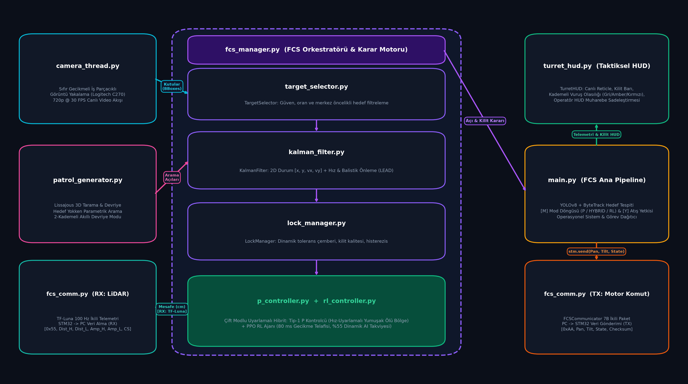
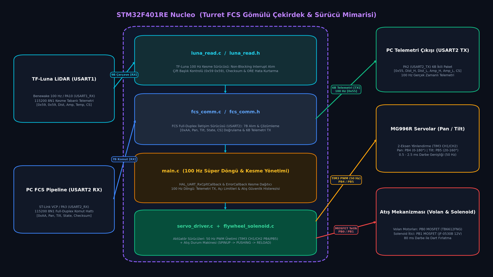
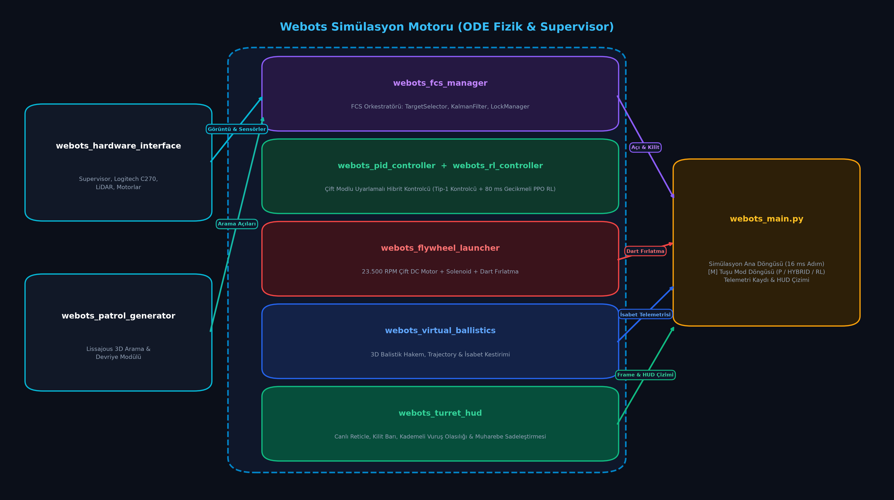
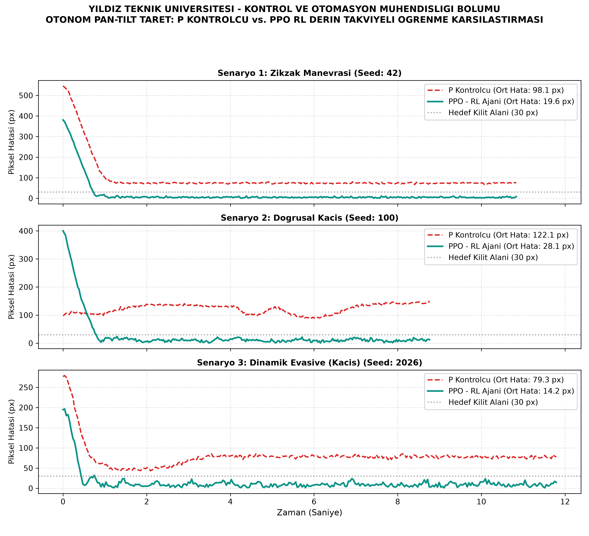

# Otonom Asimetrik Hava Tehdidi Tespit ve Atış Kontrol Sistemi (Turret FCS)
### Yıldız Teknik Üniversitesi — Kontrol ve Otomasyon Mühendisliği Bölümü
**Bitirme Çalışması & Tasarım Projesi**

[](https://www.python.org/)
[](https://www.st.com/)
[](https://cyberbotics.com/)
[](https://ultralytics.com/)
[-orange.svg)](https://stable-baselines3.readthedocs.io/)
[](https://en.wikipedia.org/wiki/Proportional_control)

Bu proje; mikro/mini İHA'lar, kamikaze dronlar ve asimetrik hava hedeflerine karşı geliştirilmiş; **Logitech C270 RGB Kamera + Benewake TF-Luna ToF LiDAR Sensör Füzyonu**, **YOLOv8n Derin Öğrenme Hedef Tespiti**, **ByteTrack Çoklu Hedef Takibi**, **Genişletilmiş Kalman Filtresi (EKF) Yörünge Kestirimi**, **Tip-1 Hız-Uyarlamalı Yumuşak Ölü Bölgeli P Kontrolcü** ve **80 ms Taşıyıcı Gecikme Telafili PPO Derin Pekiştirmeli Öğrenme (RL)** tabanlı otonom bir Elektro-Optik Atış Kontrol Sistemidir (FCS).

---

## 🎯 Temel Özellikler ve Yetenekler

* **Çift Modlu Algılama ve Sensör Füzyonu:** RGB Kamera (Logitech C270, 720p @ 30 FPS) ve TF-Luna ToF LiDAR sensörünün (100 Hz UART) yüksek hızlı veri füzyonu.
* **Yapay Zeka Destekli Hedefleme:** Gerçek zamanlı YOLOv8n nesne tespiti ve ByteTrack tabanlı çoklu hedef izleme algoritması. Hedef sınırlayıcı kutusunda sadeleştirilmiş `TARGET` etiketi.
* **Balistik ve Kinematik Kestirim (Lead Pursuit):** Hedefin 2D/3D hız ve yön vektörünü kestiren Kalman Filtresi (`kalman_filter.py`), dinamik mermi uçuş süresi önleme açısı (lead angle) ve yerçekimi balistik düşüş (süper-elevasyon) telafisi.
* **Çok Katmanlı Üçlü Kontrol Mimarisi (`[M]` Tuşu ile Değiştirilebilir):**
  * **`[P CONTROLLER]`:** Tip-1 ayrık integratör karakteristiği ile çalışan, $u = K_p \cdot e$ formunda, hız-uyarlamalı yumuşak ölü bölgeli (soft deadband) ve sıfır kalıcı durum hatalı kararlı açısal merkezleme.
  * **`[HYBRID CONTROLLER (RL:X%)]`:** Kararlı P omurgasını korurken, hedef manevralarında gecikmeyi yenmek için devreye giren dinamik PPO takviyesi (maksimum %55 AI desteği). Hedefe kilit oturunca takviye otomatik sönümlenerek merkezde sıfır titreşim sağlanır.
  * **`[RL CONTROLLER]`:** 80 ms donanım gecikme tamponu (transport delay buffer) ve çıkış hız alçak geçiren filtresi (EMA) ile eğitilmiş, tam otonom PPO ajanının doğrudan açısal hız kontrolü.
* **Taktiksel Operatör HUD (Heads-Up Display):**
  * **Renk Disiplini:** Devriye modunda **Yeşil**, Takipte **Amber**, Hedef kilitlendiğinde ve atış anında **Kırmızı**.
  * **Muharebe Yetkilendirme Paneli:** Koyu Amber (`TARGET LOCKED` / `AUTHORIZE FIRE? [Y/N]`).
  * **Kademeli Vuruş Olasılığı (Hit Probability):** Gri ($< 40\%$), Amber ($40\% - 69\%$), Kırmızı ($\ge 70\%$).
  * **Muharebe Sadeleştirmesi (Decluttering):** Kilit ve atış esnasında operatörün dikkatini dağıtmamak için sol telemetri kutusu ve sağ üst FPS göstergesi otomatik gizlenir.
* **Gömülü Donanım Mimarisi:** STM32F401RE Nucleo tabanlı 100 Hz ikili (binary) UART haberleşmeli, donanımsal limit korumalı çift MG996R servo sürücüsü, 23.500 RPM çift volan motoru ve 12V JF-0530B solenoid dart itici.
* **Dijital İkiz Simülasyonu:** Webots R2025a fizik motorunda 1:1 ölçekli aerodinamik ve mekanik simülasyon doğrulaması (%100 isabet oranı).

---

## 🏛️ Sistem ve Donanım Mimarisi

Aşağıdaki şemalar sistemin PC yazılım boru hattını, STM32 gömülü mimarisini, Webots simülasyon motorunu ve elektriksel güç dağıtım katmanını göstermektedir:

### 1. Turret FCS Yazılım Pipeline Şeması


### 2. STM32F401RE Gömülü Çekirdek & Sürücü Mimarisi


### 3. Webots Dijital İkiz Simülasyon Mimarisi


### 4. Donanım ve Güç Dağıtım Şeması
Projenin elektriksel güç dağıtımı, sensör entegrasyonu ve aktüatör bağlantıları [turret_fcs_hardware.svg](turret_fcs_hardware.svg) dosyasında detaylandırılmıştır.

```
+-----------------------------------------------------------------------------------+
|                            GÖRSEL VE SENSÖR GİRDİSİ                               |
|  [ Logitech C270 (1280x720 @ 30 FPS) ]     [ Benewake TF-Luna LiDAR (100 Hz UART) ]|
+-----------------------------------------------------------------------------------+
                                         │
                                         ▼
+-----------------------------------------------------------------------------------+
|                             HEDEF TESPİT VE İZLEME                                |
|  * YOLOv8n Derin Öğrenme Modeli (Hava Hedefi / Mini İHA Tespiti)                 |
|  * ByteTrack / Kalman Filtresi (3D Konum, Hız ve İvme Kestirimi)                  |
|  * Taktiksel Askeri HUD Arayüzü & Hedef Önceliklendirme (FCS Manager)             |
+-----------------------------------------------------------------------------------+
                                         │
                                         ▼
+-----------------------------------------------------------------------------------+
|                           KONTROL VE NİŞAN ALMA KATMANI                           |
|  * Balistik Düşüş & Dinamik Önleme Açısı Hesaplama (Ballistics Engine)            |
|  * Çok Modlu Kontrol: P Kontrolcü / Hibrit (P + PPO RL) / Saf RL                 |
|  * 80 ms Taşıyıcı Gecikme Telafisi (Lead Pursuit) & Çıkış Hız Filtresi (EMA)      |
+-----------------------------------------------------------------------------------+
                                         │
                                         ▼
+-----------------------------------------------------------------------------------+
|                        GÖMÜLÜ DONANIM / FİZİKSEL EYLEME                           |
|  * STM32F401RE Nucleo Mikrodenetleyici (100 Hz UART Kontrol Döngüsü)              |
|  * Çift Eksen Pan-Tilt MG996R Servoları (50 Hz PWM Açısal Yönlendirme)            |
|  * Çift DC Volan Motoru (23.500 RPM) ve 12V Solenoid Dart Tetik İticisi          |
+-----------------------------------------------------------------------------------+
```

---

## 🔄 Algoritmik Durum Akış Şeması (Flowchart)

Sistemin arama, tespit, takip, kilitlenme ve atış sekansları [turret_fcs_flowchart.svg](turret_fcs_flowchart.svg) dosyasında modellenmiştir:

* **DURUM 1 (Devriye / Arama):** Hedef yokken Lissajous 3D eğrileriyle parametrik tarama yapılır; HUD yeşil renktedir.
* **DURUM 2 (Tespit & Mesafe):** Hedef algılandığında TF-Luna LiDAR ile 100 Hz mesafe ve sinyal gücü doğrulanır.
* **DURUM 3 (Takip & Lead):** Kalman Filtresi hedef hızını kestirir; HUD amber rengine geçer.
* **DURUM 4 (Hibrit / P Kontrol):** Tip-1 P kontrolcü ve dinamik PPO takviyesi ile açısal gecikme sıfırlanır.
* **DURUM 5 (Hedefe Kilitlendi):** Hata eşiği yakalandığında reticle kırmızıya döner, koyu amber muharebe paneli açılır, operatörden `[Y]` atış yetkisi beklenir.
* **DURUM 6 (Ateşleme):** Volan motorları devrini alır, solenoid 80 ms darbe ile dartı fırlatır.

---

## 📊 Karşılaştırmalı Performans Analizi (P Kontrolcü vs PPO RL)

Sistem, gerçek donanımın **80 ms taşıyıcı gecikmesi** altında 3 farklı zorlu hedef manevra senaryosunda (Doğrusal, Zigzag ve Kaçınma Manevrası) test edilmiştir:



| Test Senaryosu | Klasik P Kontrolcü Ortalama Hata | PPO Takviyeli Öğrenme (RL) Hata | Hata İyileştirme Oranı |
| :--- | :---: | :---: | :---: |
| **Senaryo 1 (Doğrusal Uçuş)** | 12.83 piksel | 6.89 piksel | **+%46.3** |
| **Senaryo 2 (Zigzag Manevrası)** | 13.68 piksel | 4.79 piksel | **+%65.0** |
| **Senaryo 3 (Kaçınma Manevrası)** | 15.17 piksel | 4.15 piksel | **+%72.6** |
| **Genel Benchmark Ortalaması** | **13.89 piksel** | **5.28 piksel** | **+%62.0 Doğruluk Artışı** |

---

## 🚀 Hızlı Başlangıç ve Kurulum

### 1. Donanım ve Yazılım Gereksinimleri
* Windows 10/11 x64
* Python 3.10 veya 3.12 (*"Add Python to PATH"* seçili olmalıdır)
* STM32 Nucleo-F401RE Kartı & Logitech C270 Web Kamerası
* Benewake TF-Luna LiDAR Sensörü

### 2. Otomatik Ortam Kurulumu
Depoyu klonlayın ve ana dizindeki kurulum betiğini çalıştırın:
```bash
git clone https://github.com/brkysnturk/turret_fcs.git
cd turret_fcs
setup_env.bat
```
Bu betik sanal ortamı (`venv`) oluşturur, `pip`'i günceller ve [requirements.txt](requirements.txt) içerisindeki tüm bağımlılıkları eksiksiz yükler.

### 3. Sistemi Tek Tıkla Başlatma
Donanım kablolarını taktıktan sonra ana dizindeki başlatıcıyı çalıştırın:
```bash
main.bat
```

### 🎮 Operatör Kontrol Tuşları
* **`ESC` / `Q` :** Programı ve telemetri kaydını güvenli kapatma (`logs/telemetry_test_*.csv` dosyasını diske yazar).
* **`SPACE` (Boşluk) :** Acil Durdurma (E-STOP) — Motorları ve kilitlenmeyi anında frenler.
* **`M` :** Kontrol Modu Döngüsü (`[P CONTROLLER]` $\leftrightarrow$ `[HYBRID CONTROLLER (RL:X%)]` $\leftrightarrow$ `[RL CONTROLLER]`).
* **`P` :** 2 Kademeli Akıllı Devriye (Patrol) modunu açma / kapatma.
* **`Y` :** Manuel Atış Yetkisi (Authorize Fire).
* **`N` :** Hedef Bırakma / Aramaya Geri Dönme.

---

## 📈 Akademik Dinamik Analiz ve Sistem Tanıma

Taret kontrol dinamiklerini, FOPDT sistem tanıma sonuçlarını ve Padé kök-yer eğrilerini incelemek için `analysis/` araçları kullanılır:

```bash
# 1. 6 Panelli Detaylı Dinamik ve Kontrol Kararlılık Analizi (300 DPI)
python analysis/plot_tuned_system.py

# 2. 4 Panelli Sistem Tanıma, S-Düzlemi Root Locus ve Doğrulama
python analysis/system_identification.py

# 3. P Kontrolcü vs PPO RL Karşılaştırma Grafiği
python turret_fcs/rl_sim/compare_pid_vs_rl.py
```
*(Akademik tez veya jüri sunumu için MATLAB ortamında `analysis/turret_fcs_analysis.m` dosyasını çalıştırabilirsiniz).*

---

## 📂 Dizin Yapısı

```
turret_fcs/
├── requirements.txt           # Python kütüphane bağımlılıkları (YOLO, Torch, SB3, vb.)
├── setup_env.bat              # Otomatik sanal ortam (venv) ve kütüphane kurulum aracı
├── main.bat                   # Tek tıkla gerçek zamanlı atış kontrol başlatıcısı
├── README.md                  # Proje mimarisi ve teknik dokümantasyon
├── turret_fcs_architecture.png# 4K Turret FCS ana mimari şeması
├── stm32_architecture.png     # 4K STM32 gömülü sürücü ve kesme mimarisi
├── webots_architecture.png    # 4K Webots dijital ikiz simülasyon mimarisi
├── turret_fcs_flowchart.svg   # Vektörel algoritmik durum akış şeması (Flowchart)
├── turret_fcs_hardware.svg    # Vektörel elektriksel donanım ve güç dağıtım şeması
├── analysis/                  # Akademik kontrol ve sistem tanıma araçları
│   ├── plot_tuned_system.py   # Python 6 panelli dinamik analiz motoru
│   ├── system_identification.py # FOPDT basamak eğri uyumu ve Padé kök-yer eğrisi
│   ├── turret_fcs_analysis.m  # MATLAB akademik analiz ikizi
│   └── figures/               # Yüksek çözünürlüklü (300 DPI) yayın grafikleri
├── logs/                      # Gerçek donanım telemetri test kayıtları (.csv)
├── turret_fcs/                # Gerçek donanım çalışma kodları
│   ├── main.py                # Ana atış kontrol döngüsü ve hedef koordinasyonu
│   ├── telemetry.py           # Kare-kare donanım telemetri kaydedicisi
│   ├── fcs_manager.py         # Hedef seçim, kilit ve balistik hesap motoru
│   ├── fcs_comm.py            # STM32 UART binary paket haberleşme sürücüsü
│   ├── kalman_filter.py       # Kalman filtreli 3D yörünge ve hız kestirimi
│   ├── turret_hud.py          # Askeri standartta dinamik taktiksel HUD arayüzü
│   ├── rl_controller.py       # 80 ms gecikme telafili PPO RL cıkarım motoru
│   ├── p_controller.py        # Hız-uyarlamalı yumuşak ölü bölgeli Tip-1 P kontrolcü
│   ├── patrol_generator.py    # Lissajous 3D parametrik arama ve akıllı devriye
│   ├── target_selector.py     # Öncelikli hedef filtreleme algoritması
│   ├── camera_thread.py       # Sıfır gecikmeli çok iş parçacıklı kamera sürücüsü
│   └── rl_sim/                # Pekiştirmeli öğrenme ortamı ve eğitim araçları
│       ├── turret_env.py      # Gymnasium taret ortamı (80 ms Transport Delay Buffer)
│       ├── train_rl.py        # PPO model eğitim kodu (Stable-Baselines3)
│       ├── compare_pid_vs_rl.py # P vs RL akademik benchmark karşılaştırması
│       └── models/            # Eğitilmiş üretim PPO modeli (turret_ppo_final.zip)
├── stm32/                     # STM32F401RE Nucleo gömülü yazılım projesi (CubeIDE)
│   └── turret_main/           # Ana taret donanım projesi (.ioc, Core/Src, Core/Inc)
│       └── Core/Src/          # fcs_comm.c, servo_driver.c, luna_read.c, flywheel_solenoid.c, main.c
├── webots/                    # Webots dijital ikiz simülasyonu
│   ├── controllers/           # Simülasyon kontrolcüleri (webots_main, webots_turret_hud, vb.)
│   ├── worlds/                # 3D simülasyon dünyası ve aktörler
│   └── analysis/              # Webots performans analiz motorları ve telemetri verileri
└── weights/                   # Eğitilmiş yapay zeka model ağırlıkları (best.pt)
```

---

## 📜 Lisans & Akademik Referans
Bu proje Yıldız Teknik Üniversitesi Kontrol ve Otomasyon Mühendisliği Bölümü Bitirme Çalışması & Tasarım Projesi kapsamında geliştirilmiştir. Tüm hakları proje ekibine aittir.
