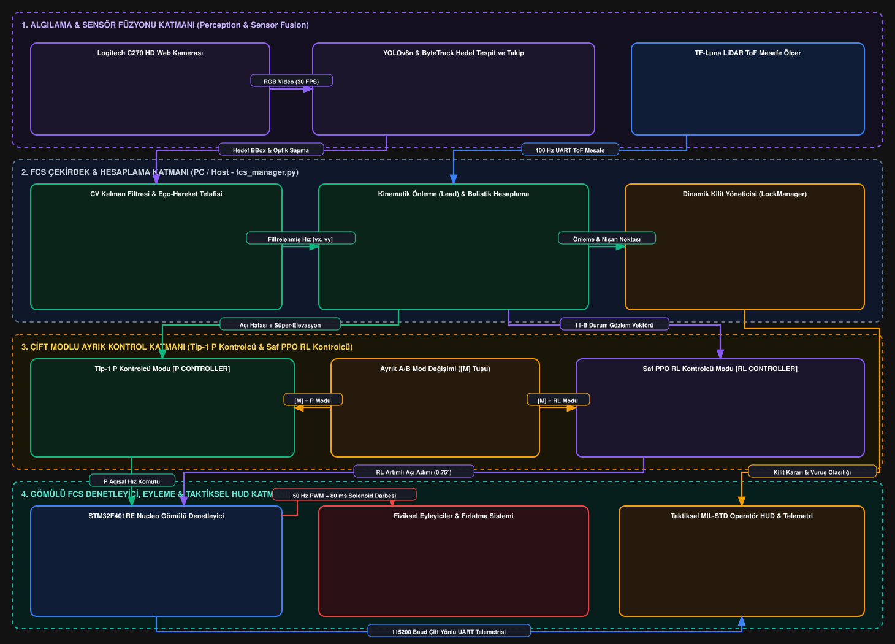

# Otonom Asimetrik Hava Tehdidi Tespit ve Atış Kontrol Sistemi (Turret FCS)

## Yıldız Teknik Üniversitesi — Kontrol ve Otomasyon Mühendisliği Bölümü

### Bitirme Çalışması & Tasarım Projesi (v1.4 Production Release)

[](https://github.com/brkysnturk/turret_fcs/releases/tag/v1.4)
[](LICENSE)
[](https://www.python.org/)
[](https://github.com/brkysnturk/turret_fcs/actions)
[](https://www.st.com/)
[](https://cyberbotics.com/)
[](https://ultralytics.com/)
[](https://stable-baselines3.readthedocs.io/)
[](https://en.wikipedia.org/wiki/Proportional_control)

Bu proje; mikro/mini İnsansız Hava Araçları (İHA) ve asimetrik hava tehditlerine karşı geliştirilmiş; **Logitech C270 RGB Kamera (720p @ 30 FPS) + Benewake TF-Luna ToF LiDAR (100 Hz UART) Sensör Füzyonu**, **YOLOv8n Derin Öğrenme Hedef Tespiti**, **ByteTrack Çoklu Hedef Takibi**, **Ego-Hareket Telafili Sabit Hızlı (CV) Kalman Filtresi**, **P (tek EMA, kazanç planlamalı, yumuşak ölü bölgeli Tip-1 P)**, **Kapalı Form 2B Gauss Vuruş Olasılığı (Marcum Q / ncx2 CDF)**, **Menzil Kapılama (Range Gating)** ve **RL (saf PPO, 11-64-64-2 NumPy çıkarım)** tabanlı tam otonom bir Elektro-Optik Atış Kontrol Sistemidir (FCS).

---

## 🚀 v1.4 Sürüm Detayları ve Temel Mühendislik İnovasyonları

`v1.4` sürümü; kontrol teorisi, balistik hesaplama, stokastik vuruş olasılığı, taktiksel arayüz (HUD) ve yazılım mimarisi açısından sistemi endüstriyel ve akademik olgunluğa ulaştıran kapsamlı bir üretim sürümüdür:

### 1. Tam 2B Gauss Vuruş Olasılığı Modeli (`turret_fcs/lock_manager.py`)
* **Kapalı Form Marcum Q / Non-Central Chi-Squared Entegrasyonu:**
  * Eski sezgisel ofset zayıflatma yaklaşımı yerine, dairesel hedef alanı üzerinde eksantrik 2B izotropik Gauss integrali kapalı formda `scipy.stats.ncx2.cdf(1, df=2, nc=(r_ofset / sigma)^2)` formülasyonuyla modellendi.
  * Hata sıfırken Rayleigh dağılımına `p_sifir = 1 - exp(-theta_hedef^2 / (2 * sigma_toplam^2))` tam olarak indirgenir; hata büyüdükçe eksantrik Gauss integrali fiziksel saçılımı kesin doğrulukla hesaplar.
* **Dinamik Hedef Açısal Boyutu:**
  * Sabit yarıçap varsayımı (0.15 m) kaldırıldı. YOLO tespit sınırlayıcı kutusundan (bounding box) piksel boyutları (`bw, bh`) ve kamera odak uzaklığı (`fx, fy`) kullanılarak anlık hedef açısal yarıçapı `theta_hedef = 0.5 * (atan(bw / (2 * fx)) + atan(bh / (2 * fy)))` olarak dinamik hesaplanır.
* **Gecikme ve Uçuş Süresi Ayrıştırması:**
  * 80 ms donanım gecikmesi uçuş süresinden ayrıştırıldı; toplam hedef saçılımı `sigma_hareket = 0.25 * omega * (t_ucus + 0.08 saniye)` ve silah dağılımı `sigma_silah = 1.25 derece` üzerinden toplam varyans `sigma_toplam = sqrt(sigma_silah^2 + sigma_hareket^2)` olarak modellenir.
* **Dinamik Histerezis Kilit Penceresi:**
  * Sabit 3.0° tolerans yerine hedef hızına duyarlı dinamik giriş eşiği (`<15 px/s: 1.60°`, `15-45 px/s: 2.20°`, `>=45 px/s: 3.00°`) ve histerezis çıkış eşiği (`lock_exit = lock_enter + 0.60°` -> 2.20° - 3.60°) ile 10 karelik kararlılık sayacı entegre edildi. Vuruş olasılığı ise 2B Gauss (ncx2) modeliyle anlık hesaplanır.

### 2. Sabit Hızlı (CV) Kalman Filtresi ve Ego-Hareket Telafisi (`turret_fcs/kalman_filter.py`)
* **Tek Katmanlı CV Modeli:**
  * Durum vektörü `X = [x, y, vx, vy]^T`, ölçüm `Z = [x, y]^T`; sabit hızlı model ve sürekli beyaz gürültülü ivme (CWNA) süreç gürültüsü kullanılır.
  * Tek bir süreç gürültüsü (`sigma_a = 300 px/s^2`) ve tek bir ölçüm gürültüsü (`r_var = 64 px^2`) vardır. Adaptif Q, hız EMA'sı, ivme sınırlaması, dönüş dedektörü, 3-kare ölçüm eğimi ve yeniden yakalama beklemesi kaldırıldı; bunlar gecikme ve yanlış yön üretiyordu.
  * Kovaryans güncellemesi Joseph formu ile sayısal olarak kararlı tutulur.
* **Ego-Hareket Telafisi:**
  * Ego kayması, son motor komutunun 30 ms birinci derece servo yanıtından üretilir. STM potansiyometre farkı kuantalanmış ve sıçramalı olduğu için ego kaynağı olarak kullanılmaz.
  * Hız durumu dünya referanslıdır; lead noktası `bbox + hız * lead_time` ile hesaplanır, filtrenin konum gecikmesi lead'e ikinci kez eklenmez.
* **Robustluk:**
  * 150 px üzerindeki tek karelik bbox sıçramasında ölçüm gürültüsü 100 kat büyütülür ve kazanç bastırılır. Aynı büyük sapma 3 kare üst üste gelirse hedef gerçekten sıçramış/yeniden yakalanmış kabul edilir; konum ölçümden, hız sıfırdan başlatılır.
  * Çıkışta yalnızca 30-60 px/s yumuşak ölü bölge bulunur; bu, duran hedefin sıfır çevresindeki gürültüsünü lead noktasından uzak tutar.
  * Gerçek telemetri ve Webots zemin gerçeği ile doğrulandı: eski filtre gerçek logda dünya LOS hızıyla 0.44 korelasyon ve %66 işaret uyumu verirken, yeni filtre 0.83 korelasyon ve %77 işaret uyumu (120 px/s üstü hızlarda %92) verir.

### 3. Üretim P Kontrolcüsü (`turret_fcs/p_controller.py`)
* **Açık Çevrim Donanımsal İntegratör (Pole at z=1):**
  * STM32 gömülü mimarisi, gelen açısal hız/adım komutlarını her 20 ms'de (`50 Hz PWM`) biriktirerek donanımsal konum üretir: `theta(k) = theta(k-1) + delta_theta(k)`.
  * Bu yapı sistem açık çevrim transfer fonksiyonuna z=1 kutbu (saf integratör) ekler. Dolayısıyla kontrol döngüsü doğal olarak Tip-1 sistemdir.
  * Statik hedefler için yazılımsal Ki integratörüne ihtiyaç duyulmaz; ancak servo ölü bölgesi ve dişli boşluğu nedeniyle pratik kalıcı hata sıfır değildir. P kontrolcü bu hatayı Ki ile değil, tek filtre ve daha yüksek doğrulanmış kazançla azaltır.
* **Üretim kontrolcüsü: PController:**
  * Tek EMA (`alpha = 0.85`); eski kontrolcüdeki `compute_angles` + `compute_p` çift filtrelemesi kaldırıldı.
  * Pan `Kp_pan = 0.22`, tilt `Kp_tilt = 0.11` (30 FPS bazında). Hata 5 dereceyi aştıkça Kp yumuşak geçişle 1.6 kata kadar artar; merkezde sakin, büyük hatada çeviktir.
  * Sabit `0.20 derece/kare` pan slew kaldırıldı; yerine pan 120, tilt 80 derece/s^2 komut ivme sınırı geldi. Böylece 6 derece/s yapay hız tavanı aşıldı, kalkış ve dönüşlerde mekanik darbe önlenmeye devam etti.
  * Ki, Kd ve hız feedforward yoktur; Kalman hızı P motoruna girmez.
  * Yumuşak ölü bölge korunur: pan 0.85 derece, tilt 0.95 derece.
* **Eski kontrolcü silindi:** Yumuşak ölü bölgeli eski P motoru kaldırıldı; v1.3 davranışı için git geçmişindeki `v1.3` etiketi kullanılır. Tek kontrolcü yolu vardır, seçici veya ortam değişkeni yoktur.
* **Webots kazanç taraması (6 profil x 8 kazanç, aynı süre ve ayarlar):**

  | Profil | 0.20 | 0.24 | 0.28 | 0.30 | 0.32 | 0.34 | 0.36 | 0.38 |
  |---|:--:|:--:|:--:|:--:|:--:|:--:|:--:|:--:|
  | Standart sinüs (2) | ✅ | – | ✅ | ✅ | ✅ | – | – | – |
  | Figure-8 (7) | ✅ | ✅ | ✅ | ✅ | ✅ | – | – | – |
  | Hızlı sinüs (3) | ✅ | ✅ | ✅ | ✅ | ✅ | – | – | – |
  | Zigzag (5) | ✅ | ✅ | ✅ | ❌ | ❌ | ❌ | ❌ | ❌ |
  | Step/hold (4) | ⚠️ | – | ❌ | ❌ | ❌ | ❌ | ❌ | ❌ |

  ✅ kararlı, ⚠️ doyum var ama kilit devam ediyor, ❌ limit cycle (komut yön değiştirme %8+, doyum %50+).
  * Standart sinüste 0.35 hâlâ kararlı, 0.39'da çöküyor.
  * Zigzag'de 0.27 hâlâ kilit oranı %89.6 ile kararlı; 0.30'da sınır, 0.34'te tam çökme.
  * Step/hold en zor profil: 0.20'de bile komut doyumu %25; 0.30'da kilit oranı %0.
  * Taban kazanç 0.22/0.11'tür. `webots_tuning.py` profili okuyup pan kazancına tavan uygular: standart/figure-8 0.32, zigzag 0.27, hızlı sinüs 0.25, step/hold 0.15.
  * Tilt taraması 0.13'ü iyi buldu; saha rezonansı sonrası nihai taban 0.22/0.11'dir.

### 4. PPO Eğitim Ortamı ve Progress Ödülü (`turret_fcs/rl_sim/turret_env.py`)
* **80 ms Donanım Gecikme Telafisi:**
  * Fiziksel servo yanıtı ve seri iletişimden kaynaklanan 80 ms (yaklaşık 2-3 görüntü karesi) taşıyıcı gecikmeyi Markovian karar sürecine dönüştürmek için 2 adımlı eylem geçmişi gözlem vektörüne dahil edildi.
  * 11-Boyutlu Durum Uzayı: `[error_x, error_y, d_err_x, d_err_y, vx, vy, dist_norm, act_hist_1 (pan, tilt), act_hist_2 (pan, tilt)]`.
* **Progress Ödül Fonksiyonu:**
  * Hata azalışını doğrudan ödüllendiren, sabit noktada motoru gereksiz yere sürmeyi cezalandıran form:
    `r = 2.0 * (e_prev^2 - e^2) - 0.05 * e^2 - 0.02 * |u|^2 - 0.08 * |du|^2 + bullseye_bonus`
* **Progress Ödüllü 250k PPO Eğitimi:**
  * v1.4'te yeniden eğitilen `turret_ppo_v14.zip` modeli; 1.20 derece dişli boşluğu, 1.50 derece/kare adım sınırı ve progress ödülüyle saf PPO olarak eğitildi. Webots profil 2'de pan RMS 1.93 derece, tilt 0.78 derece, kilitli kalma %92.5.
* **Operatör Denetimli Bağımsız Seçim:**
  * Kararsız otomatik hibrit anahtarlama yerine operatörün `[M]` tuşuyla seçtiği `[P]` ve `[RL]` modları vardır; RL saf PPO aksiyonu kullanır.

### 4b. Üretim RL Kontrolcüsü: Saf PPO (`turret_fcs/rl_controller.py`)
* **Eski RL sarmalayıcısının sorunları:**
  * Aynı açıyı P'nin EMA'sından alıp politikaya eğitimden farklı, gecikmeli bir gözlem veriyordu.
  * Eylem geçmişine filtrelenmiş motor komutunu yazıyordu; politika ise eğitimde kendi ham aksiyonunu görüyordu.
  * Çıkışta EMA + 0.10 derece/kare slew + 0.85 derece yazılım ölü bölgesi vardı; politika bunlarla eğitilmediği için mikro düzeltmeler ve eksen titremesi oluşuyordu.
  * Hedef kaybında eylem geçmişi temizlenmiyordu.
* **Yeni tasarım:**
  * Gözlem doğrudan ölçülen bbox'tan üretilir; runtime'da Kalman hızı sıfırlanır, 11 boyutlu gözlem eğitimle aynıdır.
  * Politika ağırlıkları `turret_ppo_v14_policy.npz` olarak dışa aktarılır; RL çıkarımı SB3/torch sürümüne bağımlı değildir (11-64-64-2 NumPy MLP).
  * Eylem geçmişi uygulanan normalize komutu saklar; hedef kaybında ve reset'te temizlenir.
  * Çıkışta EMA/slew yoktur. Yalnızca 5 px yumuşak ölü bölge (politikanın sıfır-hata bias'ı için) ve yön değiştiren aksiyonda 0.5 sönümleme vardır.
  * Son komut doğrudan RL aksiyonudur; P harmanı yoktur.
* Eğitim plantı: 1.20 derece dişli boşluğu, 1.50 derece/kare adım, 0.10 derece servo ölü bölgesi.
* Ödül progress formundadır: `r = 2.0 * (e_prev^2 - e^2) - 0.05 * e^2 - 0.02 * |u|^2 - 0.08 * |du|^2 + bullseye`.
* Runtime'da Kalman hızı gözlemi sıfırlanır; Webots/gerçek hız gürültüsü politikayı doyuma sokuyordu. Kalman hızı lead/HUD için canlıdır.
* Webots doğrulaması (profil 2, ilk 600 kare):

  | Kontrolcü | Pan RMS | Piksel | Kilit | Kilitli kalma | Yön değiştirme | Tilt hatası |
  |---|---:|---:|---:|---:|---:|---:|
  | **RL (saf PPO)** | **1.93°** | **40.6 px** | **%36.3** | **%92.5** | **%4.4** | **0.78°** |
  | P (0.22) | 2.07° | 42.3 px | %39.8 | %82.2 | %0.9 | 1.34° |

  * Saf RL, P'ye göre pan RMS, piksel hatası, tilt hatası ve kilitli kalma süresinde daha iyi; komut yön değiştirme oranı %4.4 ile P'nin %0.9'undan yüksek ama limit-cycle eşiği olan %8'in altında.
  * Çoklu profil doğrulaması:

  | Profil | Kontrolcü | Pan RMS | Piksel | Kilit | Kilitli kalma | Yön değiştirme | Tilt hatası |
  |---|---|---:|---:|---:|---:|---:|---:|
  | Zigzag (5) | RL | 2.34° | 42.9 px | %47.0 | %94.2 | %5.1 | 0.78° |
  | Zigzag (5) | P | 2.66° | 49.0 px | %39.5 | %80.8 | %1.6 | 1.16° |
  | Figure-8 (7) | RL | 2.06° | 43.6 px | %35.0 | %93.8 | %4.5 | 0.86° |
  | Figure-8 (7) | P | 2.14° | 43.8 px | %38.8 | %65.2 | %0.8 | 1.87° |

  * Eski RL sarmalayıcı silindi; tek RL yolu `RLController` üzerinden işler, seçici yoktur.
  * Webots'ta RL modunu açmak için `WEBOTS_CONTROL_MODE=RL`; varsayılan P'dir.
* **Dürüst süreç notu:** İlk denemelerde `servo_deadband=1.20` yanlıştı (1.5 derece/kare adımı tamamen yutuyordu), yüksek `mu_du` politikayı sabit maksimum komuta itti ve Kalman hızı gözlemi Webots'ta doyuma yol açtı. Çözüm: deadband 0.10'da kaldı, 1.20 derece ayrı backlash olarak modellendi, progress ödülü ve saf RL kullanıldı, hız gözlemi runtime'da sıfırlandı.

### 5. Kademeli Balistik Atış Protokolü, Slew/Settle Ayrımı ve Donanım Senkronizasyonu
* **Aşama 1 (0.25 s SPINUP & SLEW):**
  * Volanlar hedef kilitliyken boşta döner; `[Y]` sonrası kalan kısa sürede 23.500 RPM'e boost edilir. Bu sırada taret Kalman önleme noktasına (lead angle) yönelir.
  * **Zero-Lag Aim-Point Feedforward:** Rampanın kalıcı durum takip hatasını (`e_ss = omega / K`) yok etmek için doğrudan türevsel önleme adımı eklenir: `u = delta_slew + u_P` (`delta_slew = applied_lead - prev_applied_lead`). Hedef takibi ve Kalman filtreleme arka planda kesintisiz devam eder.
* **Aşama 2 (0.15 s SETTLE - Sabit Oturma):**
  * Slew tamamlanır; komut sabit tutulurken servo lag/backlash'in oturması beklenir. Lead ve gravity canlı kalır, nişan noktası güncellenmeye devam eder.
* **Aşama 3 (80 ms Solenoid Darbesi - FIRING):**
  * Önleme açısına ulaşıldığında STM32 donanımsal zamanlayıcısı 80 ms yükselen kenar darbeli solenoid fırlatıcıyı tetikler ve tek bir dart fırlatılır.
* **Aşama 4 (350 ms Merkeze Geri Dönüş - RECOVER):**
  * Solenoid geri çekilirken taret hedef merkezine (boresight) geri döner.
* **Aşama 5 (1.5 s Atış Değerlendirme ve Kilit Muafiyeti - EVAL & GRACE):**
  * EVAL 1.5 s ekranda gösterilir; atış sonrası kilit muafiyeti 0.75 s (22 kare @ 30 FPS) olup EVAL'in ilk yarısında çalışır. Taret optik ekseni hedefe yeniden oturana kadar yapay kilit kaybı bayrağı üretilmez.

### 6. Taktiksel MIL-STD Operatör HUD ve Muharebe Sadeleştirmesi (Combat Declutter)
* **Sorumlulukların Ayrılığı (SRP) Kapsüllemesi (`turret_fcs/turret_hud.py`):**
  * HUD çizim mantığı `main.py` ve `webots_main.py` döngülerinden arındırılarak `TurretHUD` sınıfı içerisindeki modüler metodlara (`draw_mode_banner`, `draw_footer`, `draw_event_log`) taşındı.
* **Muharebe Sadeleştirmesi (Combat Decluttering):**
  * Atış izni istendiğinde (`AUTHORIZE FIRE? [Y/N]`) ve atış protokolü boyunca ekran karmaşasını önlemek ve operatörün hedefe odaklanmasını sağlamak amacıyla:
    * Sol üst Telemetri/Durum paneli gizlenir.
    * Üst orta mod afişi gizlenir.
    * Sağ üst FPS göstergesi gizlenir.
    * Sol alt taktiksel olay günlüğü (event log) tamamen kaldırılır.
    * Alt kontrol lejantı kilitte sadeleşir, atışta tamamen gizlenir.
* **Taktiksel Askeri Terminoloji:**
  * Atış değerlendirme afişi uluslararası askeri standartlara uygun şekilde İngilizce olarak sunulur: `ENGAGEMENT COMPLETE / ENGAGEMENT SUCCESSFUL`.

### 7. Telemetri v2 ve Taktiksel Metadata Sidecar Mimarisi (`turret_fcs/telemetry.py`)
* **44 Kolonluk Genişletilmiş CSV Şeması:**
  * `schema_version`, `frame_id`, `latency_ms`, `vx_raw`, `vy_raw`, `innov_px`, `sigma_a`, `kp_eff_pan/tilt`, `db_eff_pan/tilt`, `servo_pan_fb/tilt_fb`, `sensor_temp_c`, `lock_thr` alanlarına ek olarak dünya LOS prototipinin `los_pan_deg`, `los_tilt_deg`, `los_pan_rate_deg_s`, `los_tilt_rate_deg_s` sütunlarını içeren deterministik veri kaydı.
* **JSON Metadata Sidecar (`.meta.json`):**
  * Her oturum açılışında sistem konfigürasyonu, donanım kimliği ve Git SHA kodunu; kapanışta ise toplam kare sayısı, çalışma süresi, kilit oranı ve medyan hata istatistiklerini otomatik özetler.
* **Milisaniye Hassasiyetli Olay Kütüğü (`_events.csv`):**
  * Taktiksel durum geçişleri, operatör yetkilendirmeleri ve atış sekansları olay bazlı olarak ayrı bir dosyada zaman damgasıyla tutulur.

### 8. SSOT (Single Source of Truth) ve Otomatik Test Paketi
* **Merkezi Yapılandırma (`turret_fcs/config.py`):**
  * Optik parametreler, kontrolcü kazançları, aktüatör limitleri (Pan/Tilt 1.50°/adım) ve balistik katsayılar tek bir saf matematik leaf modülünde (`CONFIG`) konsolide edildi. Model dosya yolları `CONFIG.paths` üzerinden tekilleştirildi.
* **Otomatik Test Paketi (`tests/`):**
  * 38 otomatik Pytest birim ve tutarlılık testi ile CI boru hattı üzerinden sürekli doğrulanır.
* **Standart Karşılaştırma Betiği:**
  * P ve RL karşılaştırmaları üretim `PController` ve `RLController` sınıfları üzerinden standart `turret_fcs/rl_sim/compare_p_vs_rl.py` betiğiyle 300 DPI yayın kalitesinde (`p_vs_rl_final_benchmark.png`) üretilir.

---

## 🚀 Önceki Sürüm İnovasyonları

### v1.2
* **Otonom Devriye Birikimli Adımlayıcısı:** 80-100 FPS yüksek döngü hızında MG996R mekanik ölü bölgesine takılmayı önleyen birikimli adım mekanizması (`min_dispatch_deg = 0.95 derece`) ile 90-90 merkezine eksiksiz dönüş.
* **Takip Histerezisi ve Anlık Güven (% CONF):** Arama modunda `conf = 0.28`, kilitli takipte hareket bulanıklığına karşı `conf = 0.16` dinamik güven eşiği.
* **Asimetrik Eylemsizlik Sönümlemesi:** Dikey eksendeki 300g pirinç volan namlu ağırlığının yarattığı yerçekimi momenti ve dişli boşluğu için asimetrik yumuşak ölü bölge (Pan 0.85°, Tilt 0.95°) ve adaptif sönümleme.
* **Smith Predictor Eylem Belleği:** Fiziksel testte %50.2 kilitlenme oranı, 13.16 saniye (1.061 kare @ 80.6 FPS) kesintisiz kilitlenme başarımı.
* **Hedef Kayıp (Dropout) Toleransı:** 4 karelik (`max_lost_frames`) dinamik tolerans penceresi ve aktüatör durum gözlemcisine `was_lost` bayrağı.

### v1.1
* **Menzil Kapılama (Range Gating):** Hedef namlu merkezinden uzaktayken (`angular_error > 3.0°`) TF-Luna LiDAR ışınının arkadaki duvara çarpmasını önleyen mesafe dondurma mekanizması (`last_valid_target_dist_m`).
* **Ters Kayan Pencere (Sliding Window) UART Ayrıştırıcısı:** 115200 Baud ikili veri hattında faz kayması ve gecikmeyi önleyen sağlam ayrıştırıcı.
* **300 ms STM32 Heartbeat Watchdog:** İletişim koptuğunda fırlatıcı motorlar ve solenoid için acil donanımsal frenleme (`Launcher_EmergencyStop()`).
* **Lissajous Parametrik Devriye Taraması:** Hedef yokken hava sahasını tarayan sonsuzluk yörüngesi (Pan: +/-35°, Tilt: +/-8°).

---

## 🎯 Temel Yetenekler ve Donanım Parametreleri

| Alt Sistem / Bileşen | Donanım & Yazılım Özelliği | Çalışma Parametresi / Başarım |
| :--- | :--- | :--- |
| **Görsel Algılama** | Logitech C270 HD Web Kamerası | 1280x720 @ 30 FPS, dFOV: ~56.6° (Optik Standart: 55°, Yatay 48.8°, Dikey 28.6°) |
| **Menzil Algılama** | Benewake TF-Luna ToF LiDAR | 850 nm VCSEL, 0.2 - 8.0 m menzil, 100 Hz UART |
| **Yapay Zeka Çıkarımı** | Ultralytics YOLOv8n + ByteTrack | Mini İHA / Balon tespiti, 8-15 ms çıkarım (GPU) |
| **Filtreleme & Füzyon** | Ego-Hareket Telafili CV Kalman | Tek Q/R çifti, Joseph form kovaryans, robust tek-kare sıçrama reddi |
| **Vuruş Olasılığı** | Kapalı Form 2B Gauss (Marcum Q) | ncx2 CDF, dinamik hedef boyutu, histerezis kilit |
| **Birincil Kontrolcü** | P (tek EMA, kazanç planlamalı) | Pan Kp=0.22 (6.6 1/s), Tilt Kp=0.11 (3.3 1/s) |
| **İkincil Kontrolcü** | 11-Boyutlu PPO Pekiştirmeli Öğrenme | 80 ms gecikme tamponu, LQR ödül fonksiyonu |
| **Mikrodenetleyici** | STM32F401RE Nucleo (ARM Cortex-M4) | 84 MHz, 100 Hz ikili paket UART, 300 ms Watchdog |
| **Aktüatörler** | Çift MG996R Metal Dişli Servo | 50 Hz PWM, Pan: +/-45°, Tilt: -20° / +30° |
| **Fırlatma Mekanizması** | Çift Fırçasız DC Volan + Solenoid | 23.500 RPM, 80 ms donanımsal solenoid darbesi |
| **Dijital İkiz** | Cyberbotics Webots R2025a | ODE fizik motoru, tam kinematik/dinamik model |

---

## 🏛️ Sistem ve Donanım Mimarisi

Aşağıdaki şemalar sistemin güncel PC yazılım hattını, STM32 gömülü katmanını, Webots dijital ikizini ve elektriksel/güç dağıtımını gösterir:

### 1. Turret FCS Yazılım ve Kontrol Mimarisi (güncel)


### 2. Donanım ve Güç Dağıtım Şeması
Projenin elektriksel güç dağıtımı, sensör entegrasyonu ve aktüatör bağlantıları [turret_fcs_hardware.svg](docs/assets/turret_fcs_hardware.svg) dosyasında detaylandırılmıştır.

### 3. 3D Mekanik Montaj ve Donanım Tasarımı
Taretin 3D yazıcıdan üretilen açık beşikli, minimal optik paralakslı ve gizli servo montajlı elektromekanik tasarımı:


```text
+-----------------------------------------------------------------------------------+
|                            GÖRSEL VE SENSÖR GİRDİSİ                               |
|  [ Logitech C270 (1280x720 @ 30 FPS) ]     [ Benewake TF-Luna LiDAR (100 Hz UART) ]|
+-----------------------------------------------------------------------------------+
                                         │
                                         ▼
+-----------------------------------------------------------------------------------+
|                             HEDEF TESPİT VE İZLEME                                |
|  * YOLOv8n Derin Öğrenme Modeli (Hava Hedefi / Mini İHA Tespiti)                 |
|  * ByteTrack Çoklu Hedef Takibi & Anlık Güven Histerezisi                         |
|  * Ego-Hareket Telafili CV Kalman Filtresi (Joseph Form, Tek Q/R)               |
|  * Menzil Kapılama (Range Gating) Duvar Parazit Filtreleme                        |
|  * Taktiksel MIL-STD HUD Arayüzü & Muharebe Sadeleştirmesi (Combat Declutter)    |
+-----------------------------------------------------------------------------------+
                                         │
                                         ▼
+-----------------------------------------------------------------------------------+
|                           KONTROL VE NİŞAN ALMA KATMANI                           |
|  * Kapalı Form 2B Gauss Vuruş Olasılığı (Marcum Q / ncx2 CDF)                     |
|  * Dinamik Önleme Açısı (Lead Pursuit) & Balistik Süper-Elevasyon Hesabı          |
|  * Bağımsız Modlar: Yumuşak Ölü Bölgeli Tip-1 P / 11-Boyutlu LQR-PPO RL           |
|  * 80 ms Taşıyıcı Gecikme Telafisi & Eylem Geçmişi Hafızası                       |
+-----------------------------------------------------------------------------------+
                                         │
                                         ▼
+-----------------------------------------------------------------------------------+
|                        GÖMÜLÜ DONANIM / FİZİKSEL EYLEME                           |
|  * STM32F401RE Nucleo Mikrodenetleyici (100 Hz İkili UART Protokolü)              |
|  * 300 ms Donanımsal Heartbeat Watchdog (Otomatik Güvenli Kesme)                  |
|  * Çift Eksen Pan-Tilt MG996R Servoları (50 Hz PWM Donanımsal İntegratör)         |
|  * Kademeli Atış Sekansı: 0.25 s SPINUP + 0.15 s SETTLE + 80 ms Solenoid       |
+-----------------------------------------------------------------------------------+
```

---

## 🔄 Algoritmik Durum Akış Şeması (Flowchart)

Sistemin arama, tespit, takip, kilitlenme ve kademeli atış sekansları [turret_fcs_flowchart.svg](docs/assets/turret_fcs_flowchart.svg) dosyasında modellenmiştir:

* **DURUM 1 (Devriye / Arama - PATROL):** Hedef yokken 1.5 s bekleme, merkeze dönüş ve Lissajous Figure-8 taraması (Pan: ±45°, Tilt: ±16°, 8 s) uygulanır; HUD yeşil renktedir.
* **DURUM 2 (Tespit & Mesafe - DETECT):** Hedef algılandığında TF-Luna LiDAR ile 100 Hz mesafe ve sinyal gücü doğrulanır; menzil kapılama duvar/sıçrama okumalarını eler; ByteTrack kimliği ve mekânsal kapı ile hedef kilitlenir.
* **DURUM 3 (Takip & Lead - TRACK):** CV Kalman filtresi hedef konum ve hızını kestirir, dinamik önleme noktası (`bbox + v * lead_time`) hesaplanır; HUD açık mavi renge geçer.
* **DURUM 4 (P / RL):** P (tek EMA, Kp 0.22/0.11, ivme sınırı) veya RL (saf PPO, 11-64-64-2 NumPy politika) ile açısal hata minimize edilir.
* **DURUM 5 (Hedefe Kilitlenme - LOCKED):** Açısal hata histerezis eşiğinin altına indiğinde ve 10 karelik kararlılık sayacı dolduğunda hedef kilitlenir; operatörden `[Y]` atış yetkisi istenir.
* **DURUM 6 (Kademeli Atış Protokolü):**
  * `SPINUP`: 0.25 s volan boost ve kosinüs önleme manevrası (HUD koyu kırmızı).
  * `SETTLE`: 0.15 s sabit oturma; lead/gravity canlı, servo lag/backlash oturur.
  * `FIRING`: 80 ms kenar tetiklemeli solenoid darbesiyle dart fırlatma.
  * `RECOVER`: 350 ms namlu eksenine yumuşak geri dönüş.
  * `EVAL`: 1.5 saniye ekranda `ENGAGEMENT COMPLETE / ENGAGEMENT SUCCESSFUL` taktiksel bildirim afişi gösterilir (atış sonrası kilit muafiyeti 0.75 s / 22 kare olup EVAL'in ilk yarısında çalışır).

---

## 📐 Kontrol Teorisi ve Matematiksel Modelleme

### 1. Tip-1 Oransal (P) Kontrol ve Donanımsal Ayrık İntegratör
STM32 servo sürücüsü her döngüde gelen açısal artım komutunu mevcut açıya ekler:

`theta(k) = theta(k-1) + delta_theta(k)`

Z-düzleminde transfer fonksiyonu:

`H(z) = theta(z) / delta_theta(z) = 1 / (1 - z^(-1)) = z / (z - 1)`

Sistem z = 1 noktasında kutba sahip açık çevrim bir integratördür. Kapalı çevrimde oransal denetleyici:

`delta_theta(k) = Kp * e(k)`

Basamak hedef girdisi `R(z) = 1 / (1 - z^(-1))` uygulandığında Son Değer Teoremi uyarınca kalıcı durum hatası:

`e_ss = lim_{z -> 1} (1 - z^(-1)) * E(z) = 0`

Sistem doğası gereği Tip-1 olduğundan harici yazılımsal Ki integratörüne ihtiyaç duyulmaz. Rampa tipi hareketli hedef girdisinde oluşan sonlu gecikme hatası `e_ss = omega / Kv` ise Kalman filtresinden gelen lead/önleme açısı ve atış sırasındaki doğrudan balistik slew ileri beslemesi (`Aim-Point Feedforward: u = delta_slew + u_P`) ile telafi edilir; P hız FF deneyi kapalıdır (`velocity_ff_enabled=False`).

### 2. Yumuşak Ölü Bölge (Soft Deadband) Formülasyonu
Mekanik dişli boşluğu ve aktüatör titreşimini önlemek için uygulanan parçalı sürekli fonksiyon:

`u = 0, e_abs <= db`

`u = sign(e) * Kp * (e_abs - db), e_abs > db`

Bu formülasyon sayesinde ölü bölgeden çıkış anında kontrol sinyali sıfırdan sürekli olarak başlar (sıfır jerk), mekanik vuruntu engellenir.

### 3. Kapalı Form 2B Gauss Vuruş Olasılığı (Marcum Q)
Hedef dairesi üzerinde dikey eksantriklik `r_ofset` ve silah-hareket varyansı `sigma_toplam` altında vuruş olasılığı non-central chi-squared kümülatif dağılım fonksiyonu (ncx2 CDF) ile hesaplanır:

`nc = (r_ofset / sigma_toplam)^2`

`p_vurus = ncx2.cdf(1, df=2, nc=nc) * (1 - exp(-theta_hedef^2 / (2 * sigma_toplam^2)))`

Burada:
* `theta_hedef`: Hedefin anlık açısal yarıçapı (YOLO kutusundan türetilen açısal boyut).
* `sigma_toplam = sqrt(sigma_silah^2 + sigma_hareket^2)`: Silah saçılımı (1.25°) ile hedef hareket belirsizliğinin geometrik toplamı.

### 4. PPO RL Kuadratik LQR Ödül Fonksiyonu
PPO ajanının eğitiminde simülasyon kararlılığını sağlayan normalize LQR ödülü:

`r = - (e_norm^2 + lambda_u * u_norm^2 + mu_du * du_norm^2) + r_bullseye`

Burada `lambda_u = 0.05` kontrol enerjisi regülasyonu, `mu_du = 0.02` eyleyici jerk regülasyonudur.

---

## 🛡️ Güvenlik ve Fail-Safe (Arıza Korumalı) Mimarisi

1. **300 ms Donanımsal Heartbeat Watchdog:** PC ile STM32 arasındaki seri iletişim 300 ms kesilirse, STM32 fırlatıcı motorları ve solenoid darbesini donanımsal olarak kapatır (`Launcher_EmergencyStop()`).
2. **Mandallı (Latched) Acil Durdurma (E-STOP):** Operatör `SPACE` tuşuna bastığında motorlar anında mekanik merkez (90°, 90°) konumuna kilitlenir. Tekrar `SPACE` tuşuna basılana kadar sistem hiçbir hedef komutunu işlemez.
3. **350 ms Kamera Donma Koruması:** Web kamerasından 350 ms boyunca kare gelmezse, sistem güvenli bekleme moduna geçer.
4. **Çift Atış Önleyici Yükselen Kenar Kilidi:** Solenoid darbesi 80 ms ile sınırlandırılmıştır ve tek yetkilendirmede birden fazla atış yapılması donanımsal mantıkla engellenmiştir.
5. **Açılışta Donanımsal PULL-DOWN Koruması:** STM32 ilk açıldığında ve hata durumlarında PB0/PB1 tetik hatları donanımsal dirençlerle kesin 0V seviyesinde tutulur.

---

## 📊 Karşılaştırmalı Performans Analizi (P Kontrolcü vs PPO RL)

Sistem hem gerçek donanım saha testlerinde hem de LQR simülasyon ortamında (`turret_fcs/rl_sim/compare_p_vs_rl.py`) kapsamlı olarak test edilmiştir:


### 1. Gerçek Donanım Saha Testi (v1.2 Legacy RL; v1.4 Saf RL Webots'ta Doğrulandı)

Bu tablo v1.2 legacy RL saha logudur; v1.4 saf RL henüz gerçek tarete denenmedi, sonuçları Webots profil 2/5/7 tablosundadır.

| Metrik / Performans Göstergesi | Klasik Saf Tip-1 P Kontrolcü | Legacy 11-Boyutlu PPO (v1.2) | Akademik Üstünlük / Çıkarım |
| :--- | :---: | :---: | :---: |
| **Kilitlenme Oranı (Lock Ratio)** | %39.0 | **%50.2** | **+%11.2 Daha Yüksek Kilitlenme** |
| **Azami Kesintisiz Kilit Serisi** | 147 kare (4.9 saniye) | **1.061 kare (v1.2 donanım logunda 80.6 FPS ile 13.16 saniye; 30 FPS normalize tabanında 35.37 saniye)** | **Rekor Kilit Kararlılığı** |
| **Medyan Açısal Takip Hatası** | 2.22 derece | **1.56 derece** | **%29.7 Daha Yüksek Hassasiyet** |
| **Dikey Eksen Salınımı (Limit Cycle)** | %0.1 Yön Değişimi | **%0.0 Yön Değişimi** | **Mekanik Titreşimsiz Sıfır Jerk** |
| **Gerçek Zamanlı Çıkarım Süresi (CPU)**| **0.02 ms** | **0.17 ms** | **30 FPS'te %0.5, UART 100 Hz ayrı** |

### 2. Hedef Hızına Göre Dinamik Kapalı Çevrim Takip Başarımı (30 FPS, YOLO Gürültüsü)

| Hedef Hızı | P Takip Hatası | P Kilit Koruma | RL Takip Hatası | RL Kilit Koruma |
| :---: | :---: | :---: | :---: | :---: |
| **0.0 derece/s (Statik)** | 0.71 derece | %100 | 0.67 derece | %100 |
| **2.0 derece/s (Yavaş)** | 1.47 derece | %100 | 1.19 derece | %100 |
| **5.0 derece/s (Orta)** | 2.37 derece | %100 | 1.19 derece | %100 |
| **8.0 derece/s (Hızlı)** | 3.27 derece | %0 (Rampa Hatası) | **1.41 derece** | **%100 (Tam Kilit)** |
| **10.0 derece/s (Manevra)** | 3.87 derece | %0 (Kilit Koptu) | **1.85 derece** | **%100 (Tam Kilit)** |
| **12.0 derece/s (Sınır)** | 4.47 derece | %0 | 2.74 derece | %0 |

*Çıkarım:* Tip-1 P kontrolcü statik ve düşük hızlı hedeflerde açısal hatayı soft deadband bandı içine (Pan: ±0.85°, Tilt: ±0.95°) asimptotik olarak çekip sıfır motor titreşimi sunarken, 8-10 derece/s hızındaki çevik manevralarda PPO RL modeli rampa hatasını dinamik eylem geçmişiyle kapatıp kilidi %100 korumaktadır. Operatör `[M]` tuşu ile tehdidin dinamizmine göre iki mod arasında anlık geçiş yapabilir.

### 3. Çevrimdışı Sentetik Benzetim Doğrulaması (`compare_p_vs_rl.py`)
Üretim Tip-1 P kontrolcüsü (`compute_angles` + `compute_p`) ile 250k adımlık PPO modeli, 3 farklı manevra senaryosunda (Zikzak, Doğrusal Kaçış, Dinamik Evasive) birebir aynı tohum ve 80 ms taşıyıcı gecikmesi altında test edilmiştir:
* **P Kontrolcü Ortalama Takip Hatası:** 78.03 px
* **PPO RL Ortalama Takip Hatası:** 54.62 px
* **RL Başarım Kazancı:** %+30.0 daha düşük takip hatası

---

## 🚀 Hızlı Başlangıç ve Kurulum

### 1. Sistem Gereksinimleri
* Windows 10/11 x64
* Python 3.10 veya 3.12 (*"Add Python to PATH"* seçili olmalıdır)
* STM32 Nucleo-F401RE Kartı & Logitech C270 Web Kamerası
* Benewake TF-Luna ToF LiDAR Sensörü

### 2. Otomatik Ortam Kurulumu
Depoyu klonlayın ve ana dizindeki kurulum betiğini çalıştırın:

```bash
git clone https://github.com/brkysnturk/turret_fcs.git
cd turret_fcs
setup_env.bat
```

Betik sırasıyla şunları yapar:
1. `py -3.12 / 3.11 / 3.10` veya PATH'teki uygun `python`'u seçer.
2. `venv` yoksa oluşturur; varsa ve bozuksa silip yeniden kurar.
3. `pip`'i günceller, [requirements.txt](requirements.txt) bağımlılıklarını **CPU-only PyTorch** indeksiyle kurar (2.5 GB CUDA indirmesi yapmaz).
4. `pip install -e .` ile paketi geliştirme modunda kurar.
5. `numpy`, `cv2`, `torch`, `ultralytics`, `serial` ve `turret_fcs` importlarını doğrular.

Windows'ta komut isteminde `setup_env.bat` yazın (PowerShell'de `.\setup_env.bat`). Başka bir bilgisayarda ilk kurulum yaklaşık 5-10 dakika sürer (torch CPU wheel ~200 MB).

> **Not:** `git clone` sonrası `venv` klasörü gelmez; sanal ortam her makinede yerel olarak kurulur. Webots simülasyonu için ayrıca Webots R2025a kurulmalıdır.

### 3. Test Paketini Doğrulama
Kurulumun ve modül tutarlılığının doğrulanması için otomatik test paketini (38/38 test) çalıştırın:

```bash
venv\Scripts\python.exe -m pytest -q
```

Yalnızca Python ve temel kütüphaneler gerekir; kamera, STM32 veya Webots bağlı olmasa da testler geçer. Donanım yokken eksik olan tek şey gerçek video akışıdır.

### 4. Sistemi Başlatma
Donanım kablolarını taktıktan sonra başlatıcıyı çalıştırın:

```bash
main.bat
```

`main.bat` `venv` yoksa çalışmaz ve `setup_env.bat` çalıştırmanızı söyler; sistem Python'una sessizce düşmez.

*(Webots simülatöründe çalıştırmak için `webots/worlds/webots_turret_fcs.wbt` dünyasını açın; controller otomatik başlar. P/RL modu için `WEBOTS_CONTROL_MODE=P|RL`, hedef profili için `WEBOTS_BALLOON_PROFILE=0-7`.)*

Webots balon hareketi `webots/balloon_profile.json` içindeki `active_profile` ile seçilir: 0 statik, 1 yavaş sinüs, 2 standart sinüs, 3 çevik sinüs, 4 step/hold, 5 zigzag, 6 tilt-only, 7 figure-8. Aynı profil her koşuda tekrarlanır; Bayesyen karşılaştırması için uygundur.

---

## 🎮 Operatör Kontrol Tuşları

| Tuş | Fonksiyon | Açıklama |
| :---: | :---: | :--- |
| **`ESC` / `Q`** | Güvenli Çıkış | Programı ve telemetri kaydını güvenli kapatır (`.csv`, `.meta.json`, `_events.csv`). |
| **`SPACE`** | Mandallı E-STOP | Motorları anında mekanik merkeze (90°, 90°) çeker ve kilitler. |
| **`M`** | Mod Değişimi | `[P]` ile `[RL]` arasında geçiş yapar. |
| **`P`** | Devriye Taraması | Lissajous sonsuzluk eğrisi ile otonom hava sahası taramasını açar / kapatır. |
| **`Y`** | Atış Yetkisi | Hedef kilitlendiğinde (`TARGET LOCKED`) kademeli balistik atış sekansını onaylar. |
| **`N`** | Kilit İptali | Mevcut hedef kilidini iptal eder ve aramaya döner. |

---

## 📈 Akademik Analiz ve Simülasyon Araçları

Taret kontrol dinamiklerini, FOPDT sistem tanıma sonuçlarını ve P vs RL karşılaştırmalarını incelemek için `analysis/` araçları kullanılır:

```bash
# 1. P Kontrolcü vs PPO RL Akademik Benchmark Analizi (300 DPI Görsel)
venv\Scripts\python.exe turret_fcs/rl_sim/compare_p_vs_rl.py

# 2. 6 Panelli Detaylı Dinamik ve Kontrol Kararlılık Analizi
venv\Scripts\python.exe analysis/plot_tuned_system.py

# 3. 4 Panelli FOPDT Sistem Tanıma ve Kök-Yer Eğrisi Analizi
venv\Scripts\python.exe analysis/system_identification.py

# 4. Donanım Telemetri Kütüklerinin Otomatik İncelemesi
venv\Scripts\python.exe analysis/inspect_logs.py

# 5. P vs RL kapalı çevrim teşhisi
venv\Scripts\python.exe analysis/rl_diagnose.py
venv\Scripts\python.exe analysis/p_controller_benchmark.py default --seeds 20
```

---

## 📂 Dizin Yapısı

```text
turret_fcs/
├── .github/                   # GitHub Actions CI sürekli entegrasyon iş akışları (ci.yml)
├── tests/                     # 38 otomatik Pytest birim, SSOT ve duman testi
├── requirements.txt           # Python kütüphane bağımlılıkları (YOLO, Torch, SB3, Optuna, vb.)
├── pyproject.toml             # Python paket ve yapılandırma manifestosu
├── CHANGELOG.md               # Sürüm değişiklikleri ve sürüm geçmişi
├── CITATION.cff               # Akademik alıntı ve tez referans üstverisi
├── setup_env.bat              # Otomatik sanal ortam (venv) ve kütüphane kurulum aracı
├── main.bat                   # Tek tıkla gerçek zamanlı atış kontrol başlatıcısı
├── README.md                  # Proje mimarisi ve teknik dokümantasyon
├── docs/                      # Dokümantasyon, şemalar ve CAD varlıkları
│   ├── assets/                # Güncel mimari/akış SVG'leri, CAD renderları ve donanım şeması
│   ├── cad/                   # 3D yazıcı üretim ve prototipleme dosyaları (.stl)
│   └── evidence/              # v1.2-v1.4 kıyaslama verileri (summary.md, 2 CSV test kaydı)
├── analysis/                  # Akademik kontrol, Kalman ve Webots doğrulama araçları
│   ├── export_rl_policy.py    # PPO zip -> SB3 bağımsız NumPy politika artifact'i
│   ├── rl_diagnose.py         # Ham politika / eski sarmalayıcı / temiz sarmalayıcı teşhisi
│   ├── rl_webots_eval.py      # Webots RL loglarında gerçek hata ve titreme analizi
│   ├── p_controller_validation.py # Webots P loglarında gerçek pan hatası ve komut analizi
│   ├── p_profile_sweep.py     # 6 profil x 8 kazanç Webots taraması
│   ├── kalman_validation.py   # Gerçek log ve Webots zemin gerçeğiyle Kalman doğrulaması
│   ├── system_identification.py # Sentetik FOPDT/SOPDT ve Padé kök-yer analizi
│   └── figures/               # Akademik grafikler ve metrics.json
├── runs/                      # YOLOv8 tespit modeli çıktıları
│   └── detect/balloon_detector/weights/best.pt # Özel eğitilmiş balon tespit model ağırlığı
├── turret_fcs/                # Gerçek donanım çalışma kodları
│   ├── config.py              # SSOT merkezi konfigürasyon modülü
│   ├── main.py                # Ana atış kontrol döngüsü ve hedef koordinasyonu
│   ├── telemetry.py           # v2 telemetri, JSON metadata sidecar ve event log
│   ├── fcs_manager.py         # Hedef seçim, kilit, balistik ve menzil kapılama motoru
│   ├── lock_manager.py        # Kapalı form 2B Gauss vuruş olasılığı (ncx2 CDF) ve histerezis
│   ├── fcs_comm.py            # STM32 UART binary paket sürücüsü (resync + checksum)
│   ├── kalman_filter.py       # CV Kalman, ego telafisi, sıçrama kapısı ve lead
│   ├── turret_hud.py          # Taktiksel HUD ve muharebe sadeleştirmesi
│   ├── rl_controller.py       # Üretim RL: saf PPO, NumPy 11-64-64-2
│   ├── p_controller.py        # Üretim P: tek EMA, kazanç planlama, ivme limiti
│   ├── patrol_generator.py    # Lissajous Figure-8 devriye motoru
│   ├── target_selector.py     # ByteTrack ID + mekânsal kapı + histerezis
│   ├── camera_thread.py       # Sıfır gecikmeli, watchdog korumalı kamera sürücüsü
│   └── rl_sim/                # Pekiştirmeli öğrenme ortamı ve eğitim araçları
│       ├── turret_env.py      # 11-D Gymnasium taret ortamı
│       ├── optimize_rl.py     # Optuna TPE hiperparametre optimizasyonu
│       ├── train_rl.py        # PPO eğitim kodu
│       ├── compare_p_vs_rl.py # P vs RL benchmark
│       └── models/            # turret_ppo_v14.zip + turret_ppo_v14_policy.npz (v1.3 final yedek)
├── stm32/                     # STM32F401RE Nucleo gömülü yazılım projesi (CubeIDE)
│   └── turret_main/           # Ana taret donanım projesi (.ioc, Core/Src, Core/Inc)
│       └── Core/Src/          # fcs_comm.c, servo_driver.c, luna_read.c, flywheel_solenoid.c, main.c
└── webots/                    # Webots dijital ikiz simülasyonu
    ├── controllers/           # İnce Webots HAL adaptörü (webots_main, hardware_interface, vb.)
    ├── worlds/                # 3D simülasyon dünyası ve aktörler
    └── tuning_params.json     # Webots Kp/max_output başlangıç değerleri
```

---

## 📜 Lisans & Akademik Referans

Bu proje Yıldız Teknik Üniversitesi Kontrol ve Otomasyon Mühendisliği Bölümü Bitirme Çalışması & Tasarım Projesi kapsamında geliştirilmiştir. Tüm hakları proje ekibine aittir.

Projenin akademik çalışmalarda veya yayınlarda referans gösterilmesi için:

```bibtex
@misc{turret_fcs_2026,
  author = {Senturk, Berkay and Project Team},
  title = {Autonomous Air Defense Turret Fire Control System (Turret FCS)},
  year = {2026},
  publisher = {GitHub},
  howpublished = {\url{https://github.com/brkysnturk/turret_fcs}},
  version = {v1.4}
}
```
