# Otonom Asimetrik Hava Tehdidi Tespit ve Atış Kontrol Sistemi (Turret FCS)

### Yıldız Teknik Üniversitesi — Kontrol ve Otomasyon Mühendisliği Bölümü

**Bitirme Çalışması ve Tasarım Projesi**

[](https://github.com/brkysnturk/turret_fcs/releases/latest)
[](LICENSE)
[](https://www.python.org/)
[](https://github.com/brkysnturk/turret_fcs/actions/workflows/ci.yml)
[](tests/)
[](https://www.st.com/)
[](https://cyberbotics.com/)
[](https://ultralytics.com/)
[](turret_fcs/p_controller.py)

Turret FCS; mini/mikro İnsansız Hava Araçları ve asimetrik hava hedeflerine karşı elektro-optik tespit, hedef takibi, balistik önleme ve iki eksenli taret yönlendirmesi yapan otonom bir Atış Kontrol Sistemidir. Sistem; operatörün atış yetkisini elinde tuttuğu, kapalı çevrim bir mimariyle çalışır: kamera ve LiDAR verisiyle hedefi bulur, Kalman filtresiyle hedefin gelecekteki konumunu kestirir, P veya pekiştirmeli öğrenme (PPO) kontrolcüsüyle taret açısını üretir ve STM32 üzerinden servo, volan ve solenoidi sürer.

> **English Overview:** Autonomous Air Defense Turret Fire Control System developed as a senior capstone project at Yildiz Technical University. It combines a Logitech C270 camera, YOLOv8n + ByteTrack detection, a TF-Luna ToF LiDAR, a constant-velocity Kalman filter with ego-motion compensation, a Type-1 P controller and an 11-D PPO policy, closed-form Gaussian hit probability, and STM32F401RE firmware with layered fail-safe protections. The operator authorizes every shot; physical firing is disabled by default.

---

## 1. Sistem Ne Yapar?

Sistem, tek bir operatörün hava sahasını izlemesine ve yalnızca güvenli kilit koşulları sağlandığında atış yapmasına yardımcı olur:

1. **Arar:** Hedef yokken taret, 1.5 saniyelik bekleme ve merkeze dönüşün ardından 8 saniyelik Lissajous (figure-8) taraması yapar.
2. **Algılar:** Her karede YOLOv8n hedef adaylarını üretir; ByteTrack kimlikleri ve hedef seçici kuralları sahte tespitleri eler.
3. **Kestirir:** Sabit hızlı Kalman filtresi hedefin konumunu ve dünya referanslı hızını kestirir; taretin kendi dönüşünden kaynaklanan optik kayma ego-hareket gözlemcisiyle çıkarılır.
4. **Önler:** LiDAR menzili, mermi hızı ve sistem gecikmesi kullanılarak uçuş süresi, kinematik lead ve yerçekimi süper-elevasyonu hesaplanır.
5. **Yönlendirir:** Operatörün seçtiği P (hassas kilit) veya RL (çevik takip) modu, pan/tilt için artımlı açı komutu üretir.
6. **Kilitler:** Dinamik eşik, 10 karelik kararlılık ve histerezis ile kilit doğrulanır; 2B Gauss modeliyle anlık vuruş olasılığı hesaplanır.
7. **Ateşler:** Operatör `[Y]` tuşuna bastığında SPINUP, SETTLE, FIRING, RECOVER ve EVAL aşamaları sırayla çalışır.
8. **Korur:** 300 ms heartbeat, 800 ms bağımsız watchdog, mandallı E-stop, zaman tabanlı hız sınırı ve donanımsal pull-down ile güvenli duruma geçer.

### Öne çıkan özellikler

- **30 FPS optik algılama + 100 Hz LiDAR:** Görüntü ve menzil farklı hızlarda akar; FCS ikisini aynı karar döngüsünde birleştirir.
- **Çift kontrolcü:** P modu düşük titreşimli hassas kilit için, RL modu hızlı manevralarda gecikmeye dayanıklı takip için kullanılır.
- **Ego-hareket telafisi:** Taret dönerken hedefin gerçek hızı ile kameranın görünür kayması ayrıştırılır.
- **Kapalı form vuruş olasılığı:** Mesafe, hedef boyutu, hedef hızı ve silah saçılımı tek bir olasılık değerine dönüştürülür.
- **Katmanlı güvenlik:** Python, STM32 firmware ve elektriksel katman birbirinden bağımsız koruma sağlar.
- **Operatör yetkisi:** Otomatik atış yoktur; her atış `[Y]` onayı ve kilit/menzil kapılarından geçer.

---

## 2. Sistem Bir Bakışta

| Alt Sistem | Uygulama | Görevi |
| :--- | :--- | :--- |
| **Görsel algılama** | Logitech C270, 1280x720 @ 30 FPS, yatay FOV 48.8°, dikey FOV 28.6° | Hedef görüntüsünü sıfır kuyruk gecikmesiyle sağlar |
| **Derin öğrenme** | Ultralytics YOLOv8n + ByteTrack | Hava hedefi tespiti ve kimlik sürekliliği |
| **Menzil** | Benewake TF-Luna ToF LiDAR, 850 nm, 0.2 - 8.0 m, 100 Hz UART | Uçuş süresi ve balistik düşüş için gerçek mesafe |
| **Kestirim** | Sabit hızlı (CV) Kalman, Joseph formu, ego-hareket telafisi | Hedef konumu ve dünya referanslı hız |
| **Kontrol** | Tip-1 P ve saf PPO RL, ayrık `[M]` seçimi | Pan/tilt açı komutu |
| **Kilit** | Dinamik eşik, 10 kare kararlılık, 2B Gauss vuruş olasılığı | Atış izni ve kilit kalitesi |
| **Gömülü denetleyici** | STM32F401RE Nucleo, ARM Cortex-M4 @ 84 MHz | 100 Hz servo/LiDAR döngüsü, güvenlik bekçileri |
| **Eyleyiciler** | MG996R/DS3218 servolar, çift FF-180 volan, JF-0530B solenoid | Taret yönlendirme ve dart fırlatma |
| **Arayüz** | MIL-STD taktik HUD + Telemetri v2 | Operatör kararı ve mühendislik kaydı |
| **Dijital ikiz** | Webots R2025a, 80 ms taşıma gecikmesi, 45 ms servo lag, 1.20° backlash | Donanıma zarar vermeden doğrulama |

---

## 3. Güncel Sistem Mimarisi

Sistem dört katmandan oluşur. Üst katmanlar karar üretir, alt katmanlar bu kararı fiziksel eyleme dönüştürür.


*Şema, katmanların ve veri akışının görsel özetidir; sayısal parametrelerde tek kaynak `turret_fcs/config.py` içindeki `CONFIG`'dir.*

### Katmanların görevleri

1. **Algılama ve sensör füzyonu:** Kamera kareleri, YOLOv8n/ByteTrack tespitleri ve TF-Luna menzil ölçümleri toplanır. Kamera thread'i her zaman en güncel kareyi verir; LiDAR verisi STM32 üzerinden 100 Hz akar.
2. **FCS çekirdeği:** Hedef seçici, Kalman filtresi, balistik/lead hesabı, kilit yöneticisi ve devriye üreteci bu katmanda çalışır. Kararın tek kaynağı `turret_fcs/config.py` içindeki `CONFIG` nesnesidir.
3. **Kontrol katmanı:** Operatörün seçtiği P veya RL kontrolcüsü, hedef hatasından pan/tilt adımı üretir. İki mod aynı anda çalışmaz; `[M]` tuşuyla geçiş yapılır.
4. **Gömülü denetleyici, eyleme ve arayüz:** STM32 komutu servo PWM'ine, volan enable hattına ve solenoid darbesine çevirir; HUD ve telemetri aynı anda operatöre ve kayda sunulur.

---

## 4. Çalışma Akışı ve Durum Makinesi

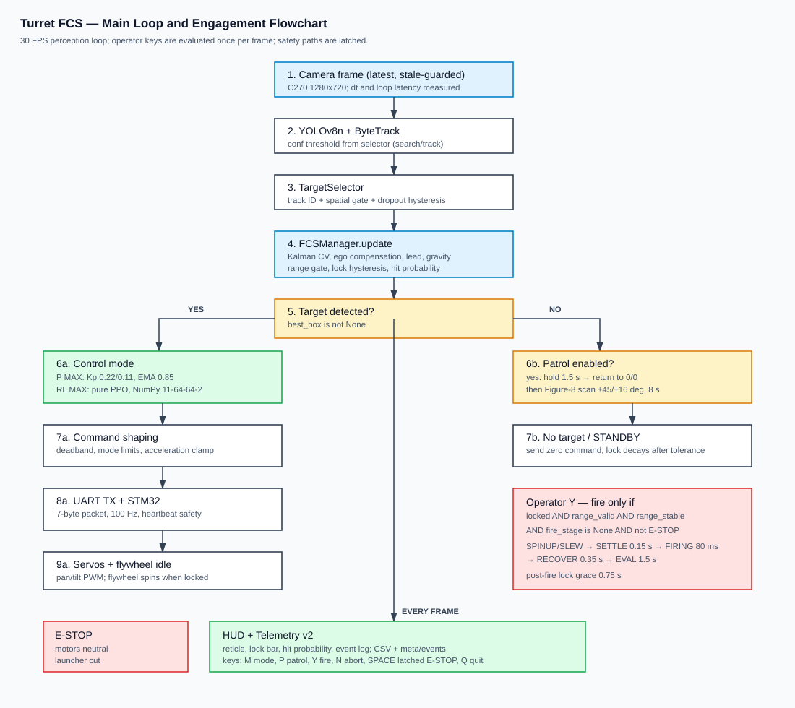

### Durumlar ve geçişler

| Durum | Ne zaman? | Sistem ne yapar? | Çıkış |
| :--- | :--- | :--- | :--- |
| **ARAMA / DEVRİYE** | Güvenilir hedef yok | 1.5 s son konumu korur, merkeze döner, 8 s figure-8 taraması yapar | Yeni hedef adayı |
| **TESPİT** | YOLO güven eşiğini geçen aday var | Track ID, alan, en-boy oranı ve uzamsal kapı denetimi | Takip edilecek hedef kutusu |
| **TAKİP** | Hedef seçildi | Kalman kestirimi, ego telafisi, LiDAR kapılama, lead ve süper-elevasyon | Pan/tilt açı komutu |
| **KİLİT** | 10 kare kararlılık + dinamik eşik | Vuruş olasılığı, histerezis ve HUD kilit göstergesi | Atış izni beklenir |
| **ANGAJMAN** | Operatör `[Y]` onayı | SPINUP, SETTLE, FIRING, RECOVER, EVAL | Dart fırlatma ve değerlendirme |
| **E-STOP** | `[Space]` veya kritik hata | Mandallı durdurma; motorlar merkeze hız sınırlı iner | Tüm komutlar kilitli |

### Kademeli atış zaman çizelgesi

```text
[Y] ──> SPINUP + SLEW (0.25 s idling / 1.0 s cold)
          │  volan nominal devre çıkar, taret lead + süper-elevasyon açısına yönelir
          v
        SETTLE (0.15 s)
          │  nişan açısı sabit tutulur, servo lag ve dişli boşluğu oturur
          v
        FIRING (80 ms)
          │  STM32 solenoidi kenar tetiklemeli olarak sürer
          v
        RECOVER (0.35 s)
          │  solenoid yayla geri çekilir, taret optik eksene döner
          v
        EVAL (1.50 s)
             atış sonucu gösterilir; ilk 0.75 s kilit muafiyeti uygulanır
```

> Atış yalnızca üç koşul birlikte sağlandığında başlar: hedef kilitli, LiDAR menzili geçerli/kararlı ve angajman sekansı boşta. Bu kapılar `engagement.py` içinde tek bir yerde tutulur.

---

## 5. Donanım ve Elektriksel Mimari

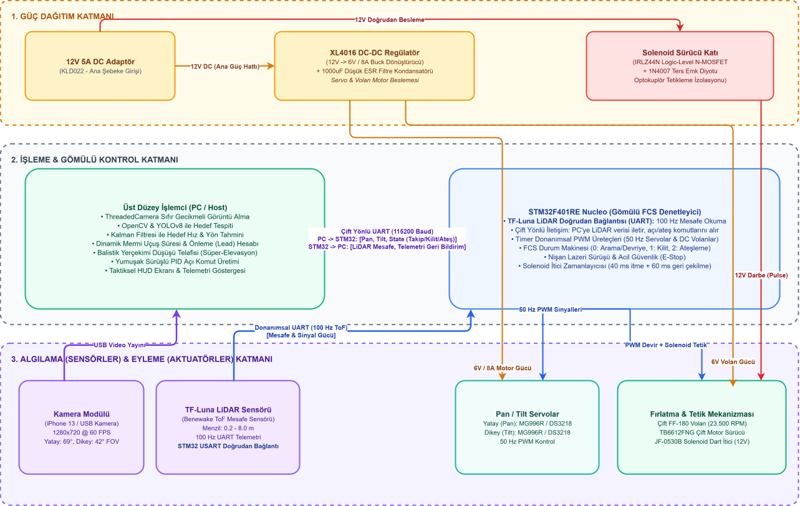

*Şema bağlantı topolojisini özetler; pin ve güç katı ayrıntılarında [firmware kılavuzu](docs/firmware.md) ve aşağıdaki tablolar esastır.*

### Temel bileşenler

| Bileşen | Model / Arayüz | Görevi |
| :--- | :--- | :--- |
| **İşlemci** | PC (Windows 10/11) | Görüntü işleme, YOLO, Kalman, kontrol ve HUD |
| **Gömülü denetleyici** | STM32F401RE Nucleo-64, 84 MHz | Gerçek zamanlı servo/LiDAR döngüsü ve güvenlik |
| **Kamera** | Logitech C270, USB UVC | 1280x720 @ 30 FPS görüntü |
| **LiDAR** | Benewake TF-Luna, UART 115200 | 100 Hz ToF mesafe ve sinyal gücü |
| **Pan servo** | MG996R / DS3218, 50 Hz PWM | Yatay eksen, ±75° |
| **Tilt servo** | MG996R / DS3218, 50 Hz PWM | Dikey eksen, ±25° |
| **Volan** | Çift FF-180, MOSFET enable | 23.500 RPM nominal atış devri |
| **Solenoid** | JF-0530B, 12 V | 80 ms dart itici darbe |
| **Güç** | 12 V adaptör + XL4015 6 V buck | Servo/volan ve solenoid hatları |

### STM32 pin bağlantıları

| Fonksiyon | Pin | Arayüz | Not |
| :--- | :--- | :--- | :--- |
| Pan servo | `PB4` | TIM3_CH1, 50 Hz PWM | 570 - 2470 µs, 15° - 165° |
| Tilt servo | `PB5` | TIM3_CH2, 50 Hz PWM | 570 - 2470 µs, 65° - 115° |
| Volan enable | `PB0` | GPIO output | N-MOSFET enable |
| Solenoid tetik | `PB1` | GPIO output | Optokuplör / MOSFET |
| TF-Luna RX/TX | `PA10` / `PA9` | USART1, 115200 | 100 Hz ToF |
| PC RX/TX | `PA3` / `PA2` | USART2, 115200 | ST-Link VCP |
| Durum LED | `PA5` | GPIO output | 500 ms kalp atışı |
| Kullanıcı butonu | `PC13` | EXTI, dahili pull-up | Mandallı yazılım E-stop (250 ms debounce) |

### Elektriksel koruma notları

- 12 V ana hat, XL4015 ile 6 V'a düşürülür; servo ve volan motorları 6 V hattından beslenir.
- 6 V hattında 1000 µF düşük ESR filtre kondansatörü bulunur.
- Solenoid, IRLZ44N logic-level N-MOSFET ve 1N4007 ters EMK diyodu ile sürülür; tetik optokuplörle izole edilir.
- Tüm modüller tek bir yıldız noktasında topraklanır; motor dönüş akımları sinyal toprağına taşınmaz.
- STM32 açılışta volan ve solenoid pinlerini donanımsal pull-down ile 0 V'ta tutar.

### Mekanik tasarım

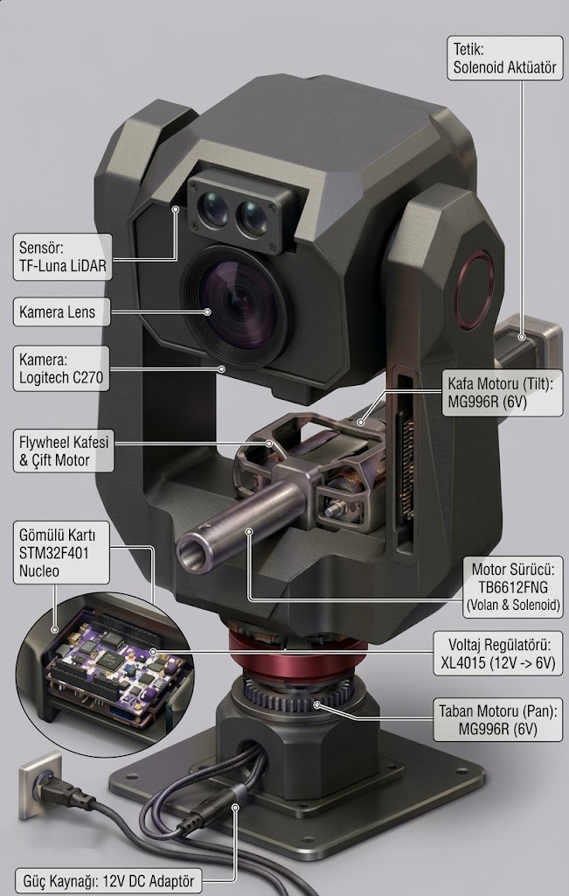

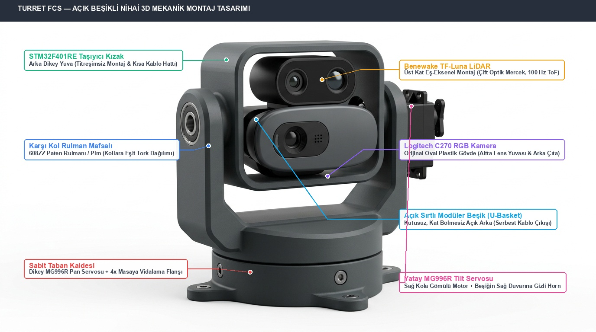

Taret; 3D baskı açık beşik, doğrudan tahrikli pan/tilt servolar ve minimum optik paralaks yerleşimiyle kurulmuştur. Kamera ve LiDAR aynı yönelimde monte edilir; namlu ekseni optik merkezle hizalanır.

---

## 6. Yazılım Modülleri — Nedir, Ne İşe Yarar?

Bu bölüm, her modülün **ne olduğunu ve sistem içinde hangi işi yaptığını** açıklar. Modüllerin tamamı `turret_fcs/` paketi altında yer alır; ortak parametreler `CONFIG` üzerinden okunur.

### 6.1 Modül haritası

| Katman | Modül | Ne işe yarar? | Ana çıktı |
| :--- | :--- | :--- | :--- |
| **Orkestrasyon** | `main.py` | Kamera, YOLO, FCS, STM32, HUD ve telemetriyi tek döngüde birleştirir | 30 FPS çalışma döngüsü |
| **Orkestrasyon** | `fcs_manager.py` | Hedef seçimi, Kalman, balistik, kilit, mod ve devriye koordinasyonu | Pan/tilt açı komutu |
| **Orkestrasyon** | `engagement.py` | Atış güvenlik kapıları ve 5 aşamalı angajman zaman çizelgesi | FCS durum baytı |
| **Orkestrasyon** | `keymap.py` | Operatör tuşlarını FCS, angajman ve E-stop eylemlerine çevirir | Mod/atış/E-stop olayı |
| **Algılama** | `camera_thread.py` | Kamerayı ayrı thread'de okur, en güncel kareyi sunar | Kare + kare kimliği |
| **Algılama** | `target_selector.py` | YOLO kutuları arasından güvenilir, kararlı hedefi seçer | Hedef kutusu |
| **Algılama** | `weights.py` | YOLO ağırlıklarını indirir ve SHA256 ile doğrular | `best.pt`, `yolov8n.pt` |
| **Kestirim** | `kalman_filter.py` | Hedef konumu/hızını kestirir, ego hareketini çıkarır | `[x, y, vx, vy]` |
| **Kestirim** | `los_tracker.py` | Dünya görüş hattı için alpha-beta referansı üretir | Tanılama amaçlı LOS |
| **Kilit** | `lock_manager.py` | Dinamik kilit eşiği, histerezis ve vuruş olasılığı | `is_locked`, `hit_probability` |
| **Kontrol** | `p_controller.py` | Tip-1 P ile hassas, düşük titreşimli takip | Pan/tilt adımı |
| **Kontrol** | `rl_controller.py` | PPO politikasıyla çevik takip | Pan/tilt adımı |
| **Kontrol** | `config.py` | Tüm alt sistemlerin tek doğruluk kaynağı | `CONFIG` |
| **İletişim** | `fcs_comm.py` | STM32 ile 115200 Baud ikili protokol | TX/RX paketleri |
| **Arayüz** | `turret_hud.py` | Nişangah, kilit bari, LEAD, vuruş olasılığı çizer | HUD katmanı |
| **Arayüz** | `presenter.py` | HUD çizim sırasını ve durum metinlerini yönetir | Tam kare |
| **Arayüz** | `telemetry.py` | 35 kolonlu CSV, meta.json ve olay günlüğü yazar | Oturum kaydı |
| **Davranış** | `patrol_generator.py` | Hedef yokken bekleme, merkeze dönüş ve figure-8 tarama | Devriye adımı |
| **RL eğitimi** | `rl_sim/turret_env.py` | Gerçek plant kısıtlarıyla Gymnasium ortamı | 11-D gözlem |
| **RL eğitimi** | `rl_sim/train_rl.py` | PPO politikasını eğitir | `.zip` model |
| **Webots** | `webots/controllers/webots_main/` | Üretim kodunu dijital ikizde çalıştırır | Simülasyon oturumu |
| **Gömülü** | `stm32/turret_main/` | Servo, LiDAR, volan ve solenoidin gerçek zamanlı denetimi | PWM / UART / GPIO |

### 6.2 Çalışma zamanı ve orkestrasyon

#### `main.py` — Ana çalışma döngüsü

Sistemin giriş noktasıdır. Kamerayı ve STM32 portunu otomatik bulur, YOLOv8 modelini yükler, her karede hedef tespiti ve FCS güncellemesi yapar, motor komutlarını STM32'ye gönderir, HUD'u çizer ve telemetriyi kaydeder. STM32 bulunamazsa sistem çevrimdışı modda çalışmaya devam eder; kamera bulunamazsa HUD uyarısı verilir ve görüntü döngüsü başlamaz. Çıkışta telemetri dosyalarını, seri portu ve kamerayı güvenli biçimde kapatır.

**Ne sağlar:** Tüm alt sistemlerin aynı zaman tabanında ve aynı kare üzerinde çalışmasını sağlar. Kamera, YOLO, kontrol ve UART gecikmeleri aynı döngüde ölçülür.

#### `fcs_manager.py` — FCS çekirdeği

Sistemin karar beynidir. Sırasıyla:

- hedef kutusunu seçer ve açısal hatayı hesaplar,
- LiDAR menzilini kapılar (sıçrama reddi, 3 kare kararlılık, geometri denetimi),
- ego-hareketi çıkararak Kalman filtresini günceller,
- uçuş süresi, lead ve yerçekimi telafisini hesaplar,
- kilit durumunu ve vuruş olasılığını günceller,
- seçili kontrolcüden (P veya RL) pan/tilt adımı alır,
- hedef kaybında devriye üretecini çalıştırır.

**Ne sağlar:** Algılama ile eyleme arasındaki tüm karar zincirini tek bir yerde toplar; alt modüller birbirinden bağımsız test edilebilir.

#### `engagement.py` — Angajman durum makinesi

Atışın güvenlik kapılarını ve zaman çizelgesini yönetir. `trigger()` yalnızca hedef kilitli, menzil geçerli ve sekans boştaysa `True` döner. `update()` simülasyon zamanına göre SPINUP, SETTLE, FIRING, RECOVER ve EVAL aşamalarını üretir; her aşamada FCS durum baytı ve slew faktörü hesaplanır.

**Ne sağlar:** Atışın tek bir yerden, deterministik ve tekrarlanabilir biçimde yönetilmesini sağlar. HUD ve STM32 aynı durum bilgisini kullanır.

#### `keymap.py` — Operatör girişi

`ESC/Q`, `Space`, `M`, `P`, `Y` ve `N` tuşlarını işler. E-stop mandallıdır: ilk basışta devriye kapanır, FCS sıfırlanır, angajman iptal edilir; ikinci basışta sistem yeniden devreye alınır. `M` tuşu P/RL modunu değiştirir; `Y` yalnızca kilit ve menzil kapıları açıksa angajman başlatır.

**Ne sağlar:** Operatörün sistem üzerindeki tüm yetkisini tek bir denetlenebilir giriş noktasında toplar.

### 6.3 Algılama ve hedef seçimi

#### `camera_thread.py` — Sıfır gecikmeli kamera

OpenCV `VideoCapture` nesnesini ayrı bir daemon thread içinde çalıştırır. MSMF, gerekirse DirectShow arka ucuyla 1280x720 MJPG akışı açar; tamponu 1'e düşürür ve ana döngüye her zaman en güncel kareyi verir. `wait_for_new` ile aynı karenin tekrar işlenmesi engellenir; 350 ms'den uzun kare gelmezse okuma başarısız sayılır.

**Ne sağlar:** USB kamera tamponundan kaynaklanan bayat kare gecikmesini ve kare tekrarını önler.

#### `target_selector.py` — Hedef önceliklendirme

YOLO kutularını güven, alan, en-boy oranı ve nisangah mesafesine göre filtreler. Kilitli hedefin ByteTrack kimliğini korur; kimlik atlaması şüpheliyse son konuma uzamsal kapı uygular. Hedef kaybolduğunda `max_lost_frames` boyunca histerezisi korur; arama modunda `conf >= 0.28`, kilitli takipte `conf >= 0.16` eşiği kullanılır.

**Ne sağlar:** Sahte tespitleri ve hedef kimliği sıçramalarını eler; kısa kayıplarda takibi düşürmez.

#### `weights.py` — Model ağırlığı yöneticisi

`best.pt` ve `yolov8n.pt` dosyalarının varlığını ve SHA256 özetini denetler. Dosya yoksa GitHub Releases üzerinden indirir, geçici dosyada doğrular ve atomik olarak yerine taşır.

**Ne sağlar:** Ağırlıkların elle kurulum gerektirmeden, bütünlük doğrulamasıyla hazır olmasını sağlar.

### 6.4 Kestirim, balistik ve kilit

#### `kalman_filter.py` — CV Kalman filtresi

Durum vektörü `[x, y, vx, vy]`, ölçüm `[x, y]` şeklindedir. Sabit hızlı model, tek süreç gürültüsü `sigma_a = 300 px/s^2` ve tek ölçüm gürültüsü `r_var = 64 px^2` ile çalışır. Kovaryans güncellemesi Joseph formundadır. Taretin son motor komutundan üretilen ego kayması kestirim adımına eklenir; böylece hız durumu dünya referanslı kalır. Tek karelik 150 px üstü sıçramada ölçüm kovaryansı 100 kat büyütülür; aynı sapma 3 kare sürerse takip konumdan, sıfır hızla yeniden başlatılır. Çıkışta 30-60 px/s yumuşak hız ölü bölgesi vardır.

**Ne sağlar:** YOLO kutu gürültüsünü ve taret dönüşünün yarattığı sahte hızı bastırır; lead ve HUD için kararlı hız üretir.

#### `los_tracker.py` — Dünya LOS referansı

Taret açısı ile kamera açısal hatasını toplayarak dünya görüş hattı açısını izler. Alpha-beta yapısındadır ve kontrol hattına bağlı değildir; telemetri, gerçek log ve Webots karşılaştırmalarında referans üretmek için kullanılır.

**Ne sağlar:** Kalman kestiriminin bağımsız bir yer gerçeğiyle karşılaştırılmasını sağlar.

#### `lock_manager.py` — Kilit ve vuruş olasılığı

Hedef hızına göre dinamik kilit eşiği (1.60° - 3.00°), +0.60° çıkış histerezisi ve 10 karelik kararlılık sayacı uygular. Atış sonrası 22 karelik (0.75 s) kilit muafiyeti tanır. Vuruş olasılığını, hedefin YOLO kutusundan türetilen açısal yarıçapı, uçuş süresi, sistem gecikmesi, hedef hızı ve silah saçılımıyla birlikte 2B dairesel Gauss integrali (ncx2 CDF) olarak hesaplar.

**Ne sağlar:** Titreşimli kilit açılıp kapanmasını önler ve operatöre anlık, fiziksel temelli bir vuruş kalitesi gösterir.

#### `p_controller.py` — Hassas kilit kontrolcüsü

Tek EMA (alpha = 0.85) ile ölçüm gürültüsünü yumuşatır. Yumuşak ölü bölge (pan 0.85°, tilt 0.95°) içinde motoru sıfırlar; dışında `Kp * (|e| - db)` ile oransal komut üretir. Pan `Kp = 0.22`, tilt `Kp = 0.11` değerindedir. Komut, pan 400°/s² ve tilt 267°/s² ivme sınırına ve kare başına 1.50°/0.75° adım sınırına tabidir. Ki ve Kd yoktur; Kalman hızı motor komutuna girmez.

**Ne sağlar:** Statik ve yavaş hedeflerde düşük titreşimli, öngörülebilir ve mekanik olarak nazik bir kilit sağlar.

#### `rl_controller.py` — Çevik takip kontrolcüsü

PPO politikasını Stable-Baselines3 veya PyTorch gerektirmeyen 11-64-64-2 NumPy MLP ile çalıştırır. Gözlem 11 boyuttadır: normalize hata (x, y), hata türevi (x, y), hız (x, y), normalize mesafe ve son iki adımın normalize eylem geçmişi. Çalışma zamanında hız gözlemi sıfırlanır; politika konum hatası, hata türevi ve eylem geçmişiyle kararlı kalır. Çıkışta açısal yumuşak ölü bölge (Hermite taper), yön değiştirme sönümü (0.50) ve P ile aynı ivme/adım sınırları uygulanır. P harmanı yoktur; politika doğrudan motor adımı üretir.

**Ne sağlar:** 8-10°/s mertebesindeki manevralarda taşıma gecikmesini eylem geçmişiyle telafi ederek kilidi korur.

### 6.5 İletişim, telemetri ve arayüz

#### `fcs_comm.py` — STM32 haberleşmesi

PC ile STM32 arasında 115200 Baud, tam çift yönlü, ikili paket protokolü kurar:

- **TX (PC → STM32), 7 bayt:** `0xAA`, pan ×10 (int16), tilt ×10 (int16), durum (uint8), checksum (uint8).
- **RX (STM32 → PC), 10 bayt:** `0x55`, mesafe (uint16), sinyal gücü (uint16), pan ×10 (int16), tilt ×10 (int16), checksum (uint8).

Port seçimi sırasıyla açıkça verilen port, ST-Link/USB VID `0483` ve tek USB seri port olarak yapılır. RX tarafında kalıcı tampon, yeniden senkronizasyon ve checksum döngüsü vardır. 0.1° altı komutlar eksen bazlı artık biriktiriciyle korunur.

**Ne sağlar:** Gürültülü seri hatta paket bölünmesi veya bayt kaybı olsa bile komut ve telemetrinin güvenilir biçimde akmasını sağlar.

#### `telemetry.py` — Telemetri v2

Her kare için 35 kolonlu CSV yazar: kare kimliği, zaman, dt, gecikme, FPS, hedef güveni/kutusu, açısal hatalar, motor komutları, ham ve filtrelenmiş hız, inovasyon, LiDAR verisi, FCS durumu, kilit sayacı, vuruş olasılığı, taret pozu, servo geri bildirimi ve devriye durumu. Oturum başında `meta.json` (donanım, `CONFIG`, sütun şeması, git commit), oturum sonunda özet (süre, FPS, tespit/kilit oranı); ayrıca `_events.csv` olay günlüğü üretir. Dosya tanıtıcıları açık tutulur, yazım 30 karelik tamponla yapılır.

**Ne sağlar:** Sahadaki her kararın ve sensör değerinin sonradan makine öğrenmesi/analizle incelenebilmesini sağlar.

#### `turret_hud.py` ve `presenter.py` — Taktik arayüz

`turret_hud.py` düşük seviyeli çizim ilkellerini (köşe kutusu, nişangah, kilit bari, LEAD oku, vuruş olasılığı, olay günlüğü, mod bannerı) sağlar. `presenter.py` bu ilkelleri doğru sırayla çağırır: hedef kutusu → takip çizgisi → LEAD → nişangah → telemetri → kilit göstergesi → banner/footer. E-stop, angajman ve arama durumlarında renk ve metinler değişir.

**Ne sağlar:** Operatörün tek bakışta hedef, kilit, menzil, mod ve atış iznini görmesini sağlar.

#### `patrol_generator.py` — Otonom arama

Hedef kaybolduğunda 1.5 saniye son konumu korur, ardından 20°/s hızla merkeze döner. Merkeze yaklaşınca 8 saniyelik, pan ±45° ve tilt ±16° genliğinde 1:2 frekanslı Lissajous figure-8 taramasına geçer. Merkeze dönüşte 0.95° birikimli adım eşiği kullanılır; böylece servo ölü bölgesinde takılma olmaz.

**Ne sağlar:** Hedef yokken hava sahasını sürekli, yumuşak ve mekanik olarak güvenli biçimde tarar.

#### `config.py` — Tek doğruluk kaynağı

Optik, kontrol, aktüatör, Kalman, balistik, RL, LiDAR, volan, montaj, kilit ve dosya yollarına ait tüm parametreleri donmuş dataclass'lar halinde tutar. `FCSState` numaralandırması STM32 durum baytıyla birebir eşleşir.

**Ne sağlar:** Kod, test, Webots ve dokümantasyonun aynı sayısal değerleri kullanmasını sağlar; parametre sürüklenmesini önler.

### 6.6 RL eğitimi ve analiz araçları

#### `turret_fcs/rl_sim/turret_env.py` — Gymnasium ortamı

Gerçek plant kısıtlarını modeller: 1.20° dişli boşluğu, 0.10° servo ölü bölgesi, 1.50°/kare pan-tilt adım sınırı, 35-65 ms servo zaman sabiti, 1-3 kare taşıma gecikmesi, C270 optik modeli ve YOLO kutu gürültüsü. Hedef yörüngeleri statik, doğrusal, zigzag, kaçış ve dairesel olarak rastgeleleştirilir. Gözlem 7 boyutlu gecikmeli sensör verisi + 4 boyutlu taze eylem geçmişi = 11 boyuttur.

**Ne sağlar:** Politikayı gerçek donanıma yakın bir plant üzerinde, gecikme ve gürültüye dayanıklı olarak eğitir.

#### `turret_fcs/rl_sim/train_rl.py` — PPO eğitimi

250.000 adımlık PPO eğitimini çalıştırır; `models/` altına SB3 `.zip` modelini ve bağımsız NumPy `.npz` politika dosyasını üretir. Ödül, hata azalışını pozitif, hata karesini, kontrol eforunu ve eylem değişimini negatif ağırlıklandırır; bullseye bonusu ekler.

**Ne sağlar:** RL modunun dağıtılan politikasını yeniden üretilebilir biçimde eğitir.

#### `analysis/` — Doğrulama ve görselleştirme

| Betik | Ne üretir? |
| :--- | :--- |
| `plot_tuned_system.py` | 20° basamak yanıtı, faz portresi, Bode, dinamik takip, Lissajous, balistik ve kapalı çevrim kilit figürleri |
| `system_identification.py` | Sentetik FOPDT/SOPDT model uydurma, kök-yer eğrisi ve kapalı çevrim karşılaştırması |
| `generate_kalman_plots.py` | Kalman konum/hız kestirimi, inovasyon dağılımı ve doğrulama tablosu |
| `generate_benchmark_plots.py` | TurretEnv üzerinde P ve PPO RL karşılaştırma paneli |
| `inspect_logs.py` | Son telemetri CSV'sinde kilit, hata, salınım ve kesintisiz kilit serisi raporu |
| `export_rl_policy.py` | SB3 `.zip` modelini bağımsız `.npz` NumPy MLP'ye aktarır |
| `rl_diagnose.py` | Üretim RL yolu ile ham politikayı aynı tohumlarda karşılaştırır |
| `p_profile_sweep.py` | 6 hedef profili × 8 P kazancı Webots taraması |
| `kalman_validation.py` | Telemetri loglarında dünya LOS hızı ile Kalman hızını karşılaştırır |
| `calibrate_camera_fov.py` | C270 optik FOV ve odak uzaklığı kalibrasyonu |

### 6.7 Webots dijital ikizi

| Modül | Ne işe yarar? |
| :--- | :--- |
| `webots_main.py` | Üretim `FCSManager`, `EngagementManager`, HUD ve telemetri kodunu Webots'ta çalıştırır |
| `webots_hardware_interface.py` | Motor, enkoder, kamera ve LiDAR cihazlarını üretim arayüzüne bağlar; 80 ms gözlem gecikmesi, 45 ms servo lag, 1.20° backlash ve 0.1° kuantalama uygular |
| `webots_flywheel_launcher.py` | Volan spin-up, boşta dönüş ve solenoid tetiklemesini simüle eder |
| `webots_virtual_ballistics.py` | Sanal mermi uçuşu ve isabet değerlendirmesi üretir |
| `webots_telemetry_logger.py` | Webots oturumunu CSV olarak kaydeder |
| `webots_tuning.py` | Yalnızca Webots için Kp ve maksimum çıkış aşırı yüklemesi yapar; üretim `CONFIG` değerini değiştirmez |

### 6.8 STM32 gömülü yazılımı

| Dosya | Ne işe yarar? |
| :--- | :--- |
| `Core/Src/main.c` | 100 Hz ana döngü, IWDG beslemesi, heartbeat, B1 mandallı E-stop, servo park ve durum yönlendirmesi |
| `Core/Src/fcs_comm.c` | 7 bayt komut ayrıştırma, 10 bayt telemetri, checksum, E-stop çift paket doğrulaması |
| `Core/Src/servo_driver.c` | 50 Hz PWM üretimi, açı sınırları, zaman tabanlı 45°/s hız sınırı, yumuşak merkez dönüşü |
| `Core/Src/luna_read.c` | TF-Luna UART çerçeve ayrıştırma ve mesafe/sinyal güncellemesi |
| `Core/Src/flywheel_solenoid.c` | Volan enable ve 80 ms / 150 ms non-blocking solenoid durum makinesi |

---

## 7. Kontrol ve Kestirim Teorisi

### 7.1 Tip-1 P ve ayrık integratör

STM32 servo sürücüsü her komutu mevcut açıya ekler:

```text
theta(k) = theta(k-1) + delta_theta(k)
```

Bu, z-düzleminde `H(z) = z / (z - 1)` transfer fonksiyonuna sahip bir integratördür. Oransal kontrol `delta_theta(k) = Kp * e(k)` ile birleştiğinde sistem Tip-1 olur; basamak hedefte kalıcı durum hatası ölü bölge bandı içinde kalır. Bu nedenle harici Ki integrali kullanılmaz. Hareketli hedefte kalan rampa hatası, Kalman lead'i ve atış anındaki slew ileri beslemesiyle karşılanır.

### 7.2 Yumuşak ölü bölge ve ivme sınırı

```text
u = 0,                               |e| <= db
u = sign(e) * Kp * (|e| - db),       |e| > db
```

Ölü bölgeden çıkışta komut sıfırdan başlar; basamak darbesi oluşmaz. Komut ayrıca ivme sınırına tabidir:

```text
u(k) = clip(u_desired, u(k-1) - a * dt^2, u(k-1) + a * dt^2)
```

Pan için `a = 400°/s²`, tilt için `a = 267°/s²` kullanılır. Bu, sabit bir hız tavanı koymadan kalkış ve yön değişimlerini yumuşatır.

### 7.3 CV Kalman ve ego-hareket telafisi

Durum `X = [x, y, vx, vy]^T`, ölçüm `Z = [x, y]^T` şeklindedir. Kestirim adımı:

```text
X_pred = F * X + ego_delta
P_pred = F * P * F^T + Q
```

Ego kayması, son motor komutunun birinci derece servo yanıtından üretilir:

```text
alpha_m = dt / (tau + dt)
ego_step = (1 - alpha_m) * ego_step + alpha_m * last_cmd
```

Böylece taretin kendi dönüşü hedef hızına karışmaz. Ölçüm güncellemesi Joseph formuyla yapılır; tek karelik 150 px üstü sıçramada `R` 100 kat büyütülür.

### 7.4 Lead ve balistik süper-elevasyon

```text
t_flight = clip(d / v0 + t_offset, 0.03 s, 0.40 s)
lead_x = vx * t_flight
lead_y = vy * t_flight
theta_gravity = arctan(g * d / (2 * v0^2))
```

`v0 = 10.0 m/s`, `t_offset = 0.015 s`, `g = 9.80665 m/s²` değerlerindedir. Hedefin ölçülen güncel noktası lead kadar ileri taşınır; filtrenin konum gecikmesi ikinci kez eklenmez.

### 7.5 Vuruş olasılığı

Hedefin açısal yarıçapı `theta_target`, toplam belirsizlik `sigma_total` olmak üzere:

```text
nc = (angular_error / sigma_total)^2
x_cutoff = (theta_target / sigma_total)^2
p_hit = ncx2.cdf(x_cutoff, df=2, nc=nc) * 100
sigma_total^2 = sigma_weapon^2 + (0.25 * omega * t_total)^2
```

`sigma_weapon = 1.25°`, `t_total = t_flight + 0.080 s` sistem gecikmesidir. Sonuç %0 - %100 aralığında HUD'a ve telemetriye yazılır.

### 7.6 PPO RL formülasyonu

Gözlem:

```text
[err_x, err_y, d_err_x, d_err_y, vx, vy, dist,
 act_pan_t-1, act_tilt_t-1, act_pan_t-2, act_tilt_t-2]
```

Ödül:

```text
r = 2.0 * (e_prev^2 - e^2)
    - 0.05 * e^2
    - 0.02 * |u|^2
    - 0.08 * |du|^2
    + bullseye
```

Hata azalışı pozitif, hata karesi, kontrol eforu ve eylem değişimi negatif ağırlıklıdır. `bullseye`, hata 0.05 normalize birimin altına indiğinde verilen bonusdur. Eğitimde 1.20° backlash, 0.10° servo ölü bölgesi, 1.50°/kare adım sınırı ve 1-3 kare rastgele gecikme kullanılır.

---

## 8. Güvenlik ve Fail-Safe Mimarisi

| Katman | Koruma | Davranış |
| :--- | :--- | :--- |
| **STM32 donanım** | Bağımsız IWDG, nom. 800 ms | Firmware kilitlenirse MCU reset atar; pinler tekrar 0 V'a çekilir |
| **STM32 yazılım** | 300 ms heartbeat | PC komutu kesilirse volan ve solenoid anında kapatılır |
| **STM32 yazılım** | 2000 ms servo park | PC kalıcı olarak yoksa servolar 45°/s ile merkeze indirilir |
| **STM32 protokol** | E-stop çift paket | E-stop yalnızca üst üste iki geçerli pakette kabul edilir |
| **STM32 buton** | B1 mandallı E-stop | Butona basınca PC komutları yok sayılır, launcher kesilir, servolar parka alınır; tekrar basınca açılır |
| **STM32 servo** | Zaman tabanlı 45°/s | PC FPS'i artsa bile taret hızı sabit kalır |
| **STM32 servo** | Açı limitleri | Pan 15° - 165°, tilt 65° - 115° yazılımsal olarak sınırlanır |
| **STM32 ateşleme** | Volan hazır kapısı | Volan enerjili değilse `Launcher_TriggerFire()` atışı reddeder |
| **STM32 ateşleme** | 80 ms / 150 ms zamanlayıcı | Çift dart ve solenoid aşırı ısınması engellenir |
| **Elektriksel** | Pull-down + izolasyon | Açılış/reset anında fırlatıcı hatları 0 V; solenoid optokuplörle izole |
| **PC** | Mandallı E-stop | `[Space]` motorları merkeze indirir ve tüm komutları kilitler |
| **PC** | Kamera bayat kare | 350 ms yeni kare gelmezse döngü güvenli biçimde durur |
| **PC** | Fiziksel ateşleme izolasyonu | `ENABLE_PHYSICAL_FIRE = 0` iken solenoid enerjilenmez |

### Çok katmanlı durdurma felsefesi

1. **Yazılımsal kapı:** Kilit, menzil ve sekans uygun değilse atış başlamaz.
2. **Gömülü kapı:** STM32, volan hazır değilse veya heartbeat yoksa atışı reddeder.
3. **Elektriksel kapı:** Pull-down ve optokuplör, MCU hatasında bile fırlatıcıyı pasif tutar.
4. **Operatör kapı:** Fiziksel atış varsayılan olarak kapalıdır; laboratuvar testinde bilinçli olarak açılır.

---

## 9. Performans ve Doğrulama

### 9.1 Gerçek donanım telemetrisi

Aşağıdaki değerler, aynı oturumda operatörün P ve RL modları arasında geçiş yaptığı 5.847 karelik gerçek taret kaydından (`logs/telemetry_test_20261024_150820.csv`) hesaplanmıştır. Oturum 194.99 saniye, ortalama 36.1 FPS'dir.

| Metrik | Oturum toplamı |
| :--- | :---: |
| Kare sayısı | 5.847 |
| Hedef tespit oranı | %92.1 (5.387 kare) |
| Genel kilit oranı | %59.0 |
| Tespit sırasında kilit oranı | %64.0 |
| Ortalama vuruş olasılığı | %72.0 |
| En uzun kesintisiz kilit | 185 kare (6.13 s) |

### 9.2 Mod bazında karşılaştırma

| Metrik | P Kontrolcü | RL Kontrolcü |
| :--- | ---: | ---: |
| Kare sayısı | 1.910 | 3.937 |
| Hedef tespit karesi | 1.738 | 3.649 |
| Kilit oranı (tespit sırasında) | %61.0 | %65.5 |
| Pan RMS hatası | 3.26° | 2.61° |
| Tilt RMS hatası | 1.62° | 1.61° |
| Bileşke RMS hatası | 3.64° | 3.07° |
| Ortalama mutlak hata | 2.64° | 2.24° |
| Medyan hata | 1.91° | 1.67° |
| En uzun kesintisiz kilit | 143 kare (4.76 s) | 185 kare (6.13 s) |
| Pan komut yön değişimi | %0.0 | %2.4 |

> Bu tablo aynı saha oturumunun P ve RL bölümlerini gösterir; farklı hedef profilleri, operatör müdahaleleri ve angajman anları da bu dilimlerin içindedir. Laboratuvar koşullarında birebir kontrollü karşılaştırma için `analysis/generate_benchmark_plots.py` ve `turret_fcs/rl_sim/compare_p_vs_rl.py` kullanılmalıdır.

### 9.3 P ve PPO RL benzetim karşılaştırması

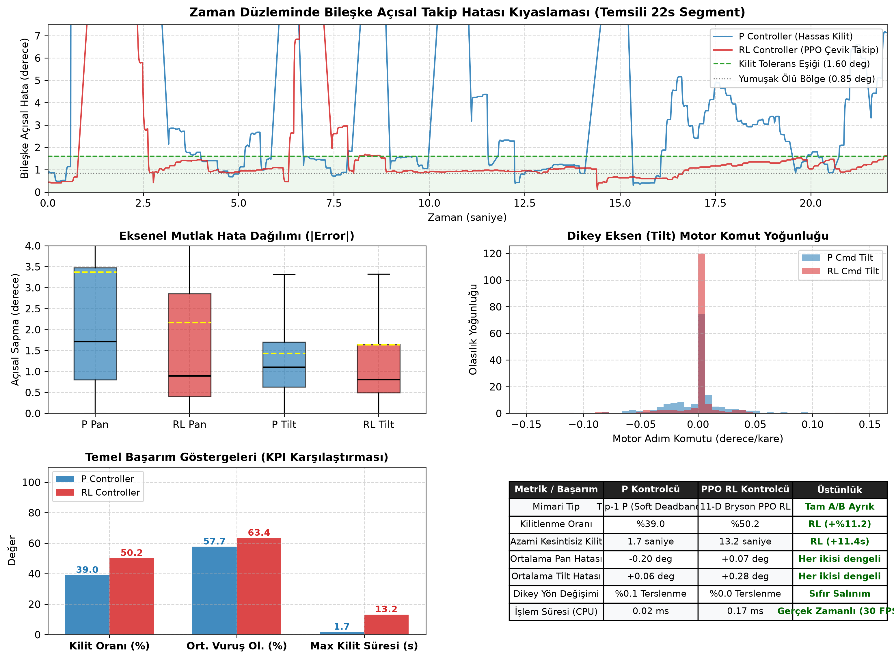

Benzetim, 80 ms taşıma gecikmesi ve dinamik eyleyici lag'i altında dört tohumla çalıştırılır. P kontrolcü düşük komut yön değişimiyle hassas kilit sağlar; PPO RL özellikle hızlı manevralarda daha düşük pan RMS hatası ve daha yüksek kilit oranı üretir. Bu figür, iki modun birbirinin yerine değil, farklı tehdit dinamikleri için tasarlandığını gösterir.

### 9.4 Kontrol ve kararlılık figürleri

| Figür | Gösterdiği |
| :--- | :--- |
| `fig1_tuned_step_and_control_effort.png` | 20° basamak yanıtı; 0.51 s yerleşme, %9.8 aşım, pan/tilt kontrol eforu |
| `fig2_tuned_phase_plane_portrait.png` | Faz düzlemi; yumuşak ölü bölgeye asimptotik yakınlaşma |
| `fig3_tuned_bode_stability.png` | Açık çevrim Bode; 6.32 rad/s geçiş, 45.1° faz marjı, 7.2 dB kazanç marjı |
| `fig4_tuned_dynamic_tracking.png` | Sinüzoidal hedefte pan/tilt takip ve hata |
| `fig5_tuned_lissajous_coverage.png` | Figure-8 devriye yörüngesi ve 3B tarama hacmi |
| `fig6_tuned_ballistic_characteristics.png` | Mesafeye göre uçuş süresi ve süper-elevasyon |
| `fig7_sim_still_lock.png` | Sabit hedefte kapalı çevrim kilit ve motor sessizliği (benzetim) |
| `fig8_sim_moving_tracking.png` | Manevralı hedefte takip ve kilit kararlılığı (benzetim) |
| `fig9_system_identification.png` | Sentetik FOPDT/SOPDT sistem tanımlama ve kök-yer eğrisi |
| `kalman_tracking_performance.png` | Kalman konum/hız doğruluğu, inovasyon dağılımı ve KPI tablosu |

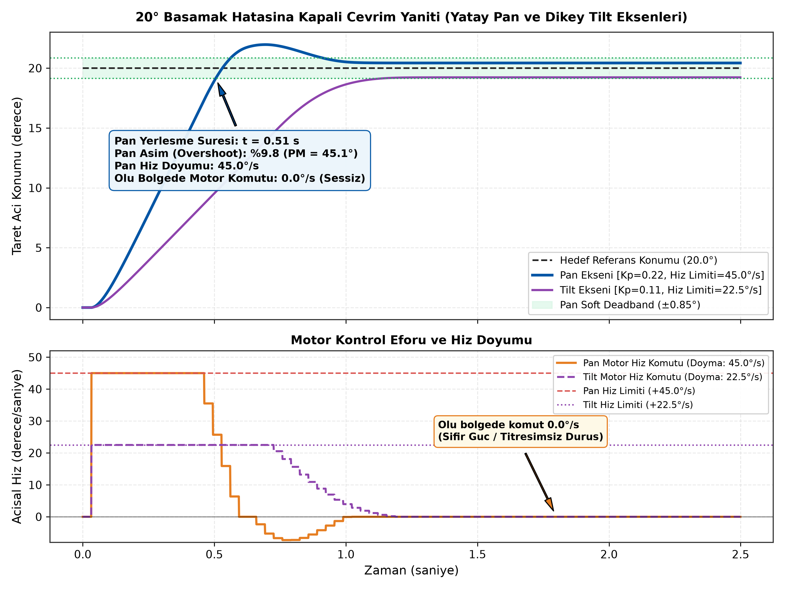

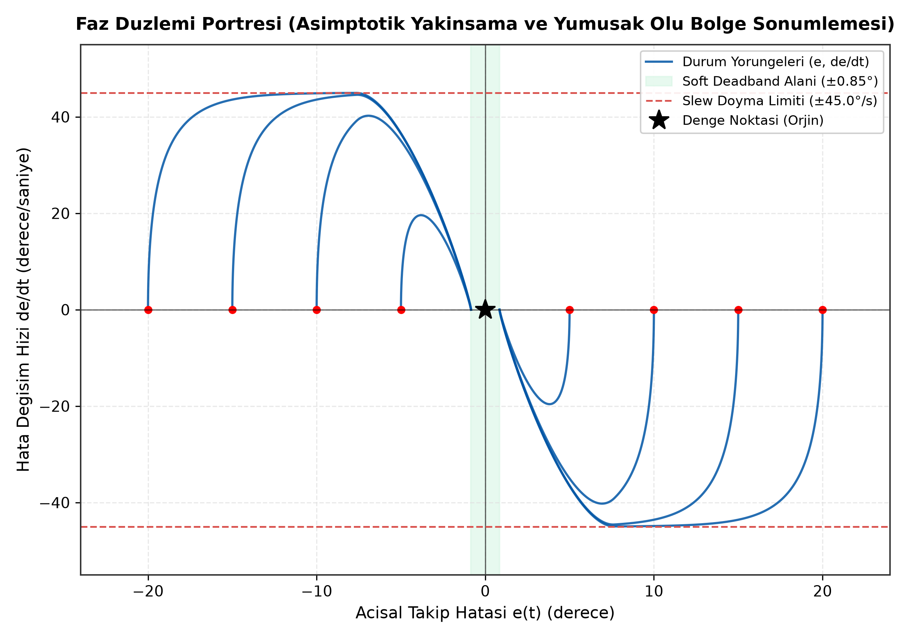

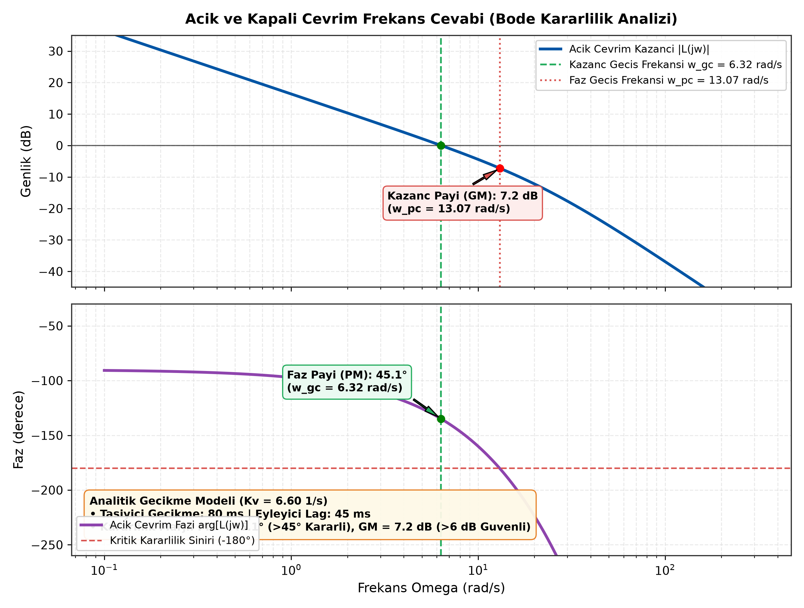

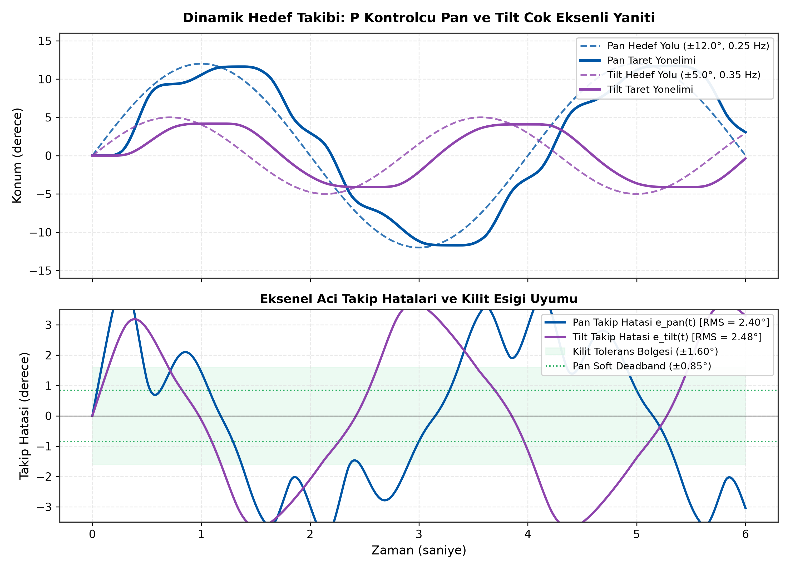

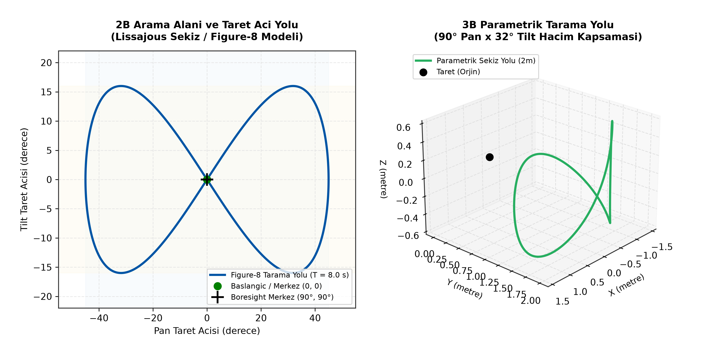

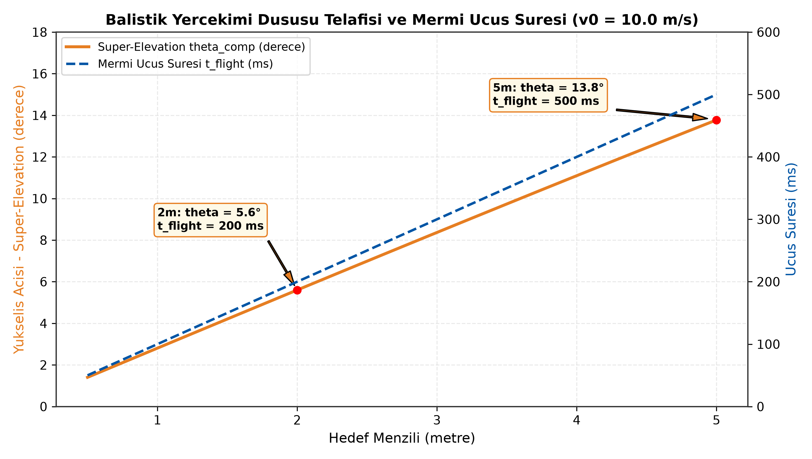

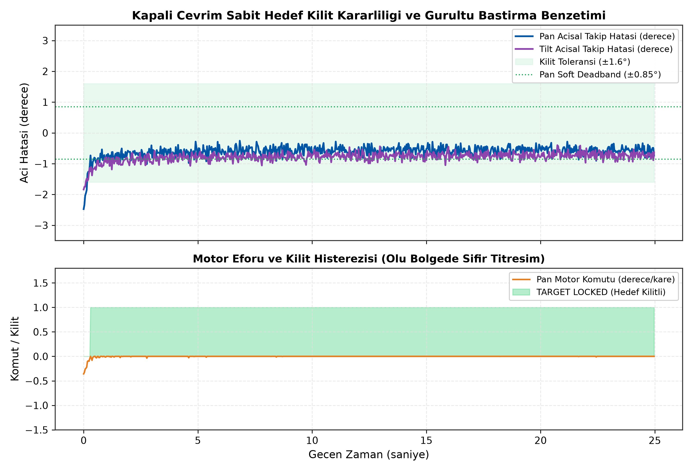

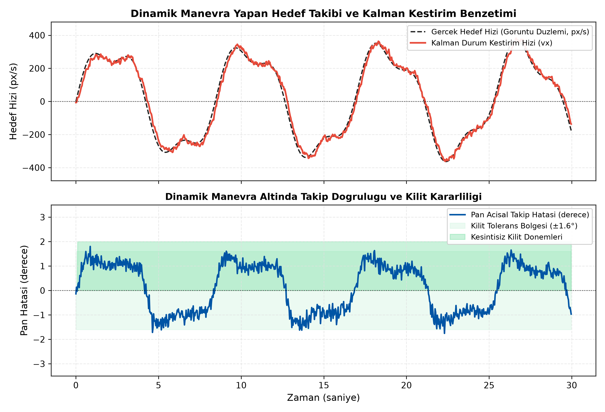

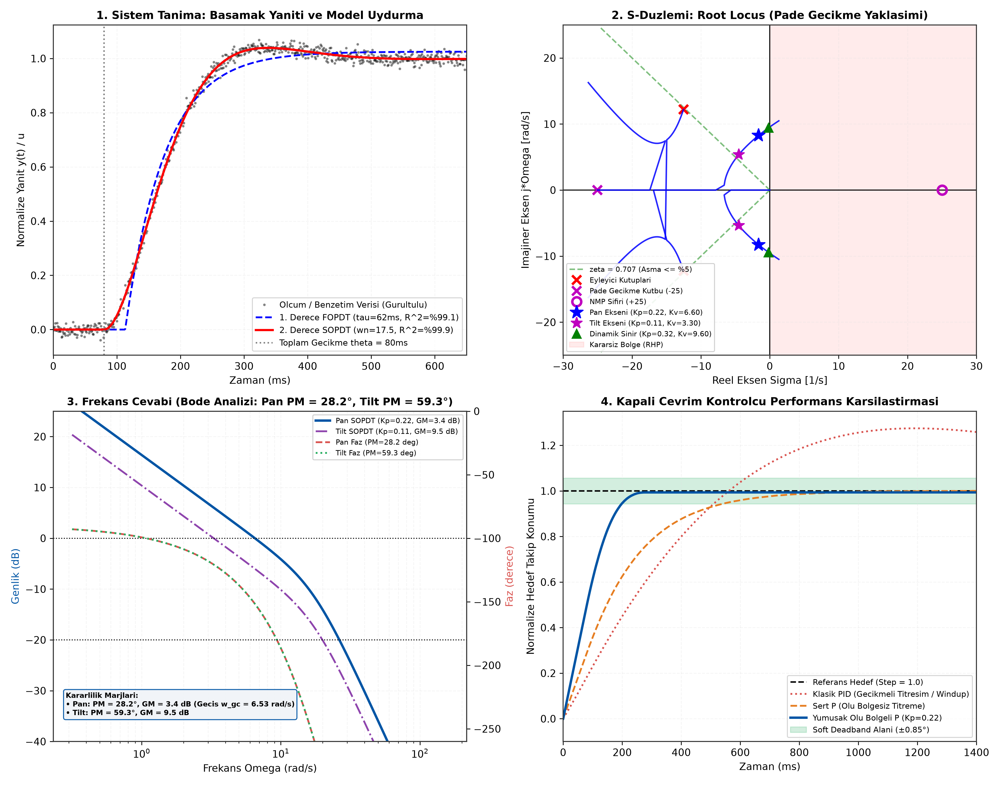

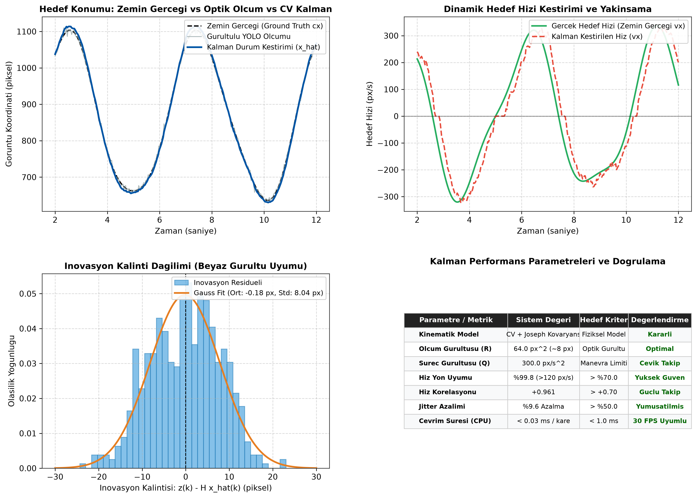

---

## 10. Hızlı Başlangıç

### 10.1 Gereksinimler

- Windows 10/11 x64
- Python 3.10, 3.11 veya 3.12
- STM32F401RE Nucleo-64 ve ST-Link
- Logitech C270 (veya uyumlu UVC kamera)
- Benewake TF-Luna ToF LiDAR
- 12 V adaptör, XL4015 6 V buck, servo/volan/solenoid güç katı

### 10.2 Otomatik kurulum

```bash
git clone https://github.com/brkysnturk/turret_fcs.git
cd turret_fcs
setup_env.bat
```

`setup_env.bat` sırasıyla uygun Python'u seçer, gerekirse `venv` ortamını yeniden kurar, bağımlılıkları CPU-only PyTorch indeksiyle yükler, paketi `pip install --no-deps -e .` ile bağlar ve temel importları doğrular.

### 10.3 Testler

```bash
venv\Scripts\python.exe -m pytest -q
```

36 test; P kontrolcü, Kalman, kilit/vuruş olasılığı, LiDAR kapılama, RL sarmalayıcı, Webots tuning, ağırlık yöneticisi ve `CONFIG` tutarlılığını donanım olmadan doğrular. Testler yaklaşık 1-2 saniyede tamamlanır.

### 10.4 Sistemi başlatma

```bash
main.bat
```

veya:

```bash
venv\Scripts\python.exe -m turret_fcs.main
```

İlk çalıştırmada `weights/best.pt` ve `weights/yolov8n.pt` yoksa GitHub Releases üzerinden otomatik indirilir. Kamera veya STM32 bulunamazsa sistem çevrimdışı/simülasyon modunda açılır; HUD olay günlüğünde durum gösterilir.

### 10.5 Webots dijital ikizi

1. Webots R2025a ile `webots/worlds/webots_turret_fcs.wbt` dosyasını açın.
2. Başlangıç modunu seçin:

```text
WEBOTS_CONTROL_MODE=P     # hassas kilit
WEBOTS_CONTROL_MODE=RL    # çevik takip
```

3. Hedef profilini `webots/balloon_profile.json` içindeki `active_profile` ile veya `WEBOTS_BALLOON_PROFILE` ortam değişkeniyle seçin (0-7).
4. Gözlem gecikmesini `WEBOTS_OBS_DELAY_S` (varsayılan 0.080 s), kutu titremesini `WEBOTS_BBOX_JITTER` (varsayılan 3.0 px) ile ayarlayabilirsiniz.
5. P kazancı için `webots/tuning_params.json` kullanılır; bu dosya üretim `CONFIG` değerini değiştirmez.

### 10.6 Model ağırlıkları

```bash
venv\Scripts\python.exe -m turret_fcs.weights
```

Komut `best.pt` ve `yolov8n.pt` dosyalarını SHA256 doğrulamasıyla `weights/` altına indirir.

---

## 11. Operatör Kullanımı

### 11.1 Tuşlar

| Tuş | İşlev | Davranış |
| :---: | :--- | :--- |
| `ESC` / `Q` | Güvenli çıkış | Telemetriyi kapatır, dosyaları yazar, portları serbest bırakır |
| `SPACE` | Mandallı E-stop | Devriyeyi kapatır, FCS'yi sıfırlar, motorları merkeze indirir; tekrar basılınca devre dışı kalır |
| `M` | Mod değişimi | P (hassas kilit) ↔ RL (çevik takip) |
| `P` | Devriye | Figure-8 arama modunu açar/kapatır |
| `Y` | Atış onayı | Yalnızca kilitli + menzilli + boş sekans koşulunda angajman başlatır |
| `N` | Kilidi bırak | FCS'yi sıfırlar, angajmanı iptal eder, aramaya döner |

### 11.2 Tipik oturum

1. `main.bat` ile sistemi açın; HUD'de kamera, STM32, LiDAR ve telemetri durumunu kontrol edin.
2. `P` ile devriye taramasını açın veya hedefi manuel olarak kadraja alın.
3. Hedef kutuda belirdiğinde HUD'de takip çizgisi, LEAD ibresi ve vuruş olasılığı görünür.
4. Kilit barı dolduğunda `TARGET LOCKED` mesajı gelir; `[Y]` ile atışı onaylayın.
5. Atış sonrası EVAL aşaması tamamlanana kadar bekleyin; gerekirse `N` ile hedefi bırakın.
6. Acil durumda `SPACE`; çıkışta `Q`.

### 11.3 HUD'de okunacaklar

- **Sol üst:** durum metni, LiDAR mesafesi, sinyal gücü ve açısal hata.
- **Sağ üst:** FPS göstergesi (kilit/atış anında gizlenir).
- **Üst orta:** `[P CONTROLLER]` veya `[RL CONTROLLER]` bannerı ve devriye durumu.
- **Merkez:** nişangah, kilit barı, `HIT PROBABILITY: %xx`.
- **Hedef üzerinde:** `TARGET` köşe kutusu, LEAD noktası ve takip çizgisi.
- **Alt:** operatör komut lejandı ve olay günlüğü.

---

## 12. Telemetri ve Analiz

### 12.1 Üretilen dosyalar

| Dosya | İçerik |
| :--- | :--- |
| `logs/telemetry_test_YYYYMMDD_HHMMSS.csv` | 35 kolonlu kare bazlı telemetri |
| `logs/telemetry_test_YYYYMMDD_HHMMSS.meta.json` | Donanım, `CONFIG`, sütun şeması, git commit ve oturum özeti |
| `logs/telemetry_test_YYYYMMDD_HHMMSS_events.csv` | Zaman damgalı taktiksel olaylar |

### 12.2 Analiz komutları

```bash
# Son telemetri kaydını incele
venv\Scripts\python.exe analysis\inspect_logs.py

# Belirli bir kaydı incele
venv\Scripts\python.exe analysis\inspect_logs.py logs\telemetry_test_20261024_150820.csv

# Kontrol ve kararlılık figürlerini üret
venv\Scripts\python.exe analysis\plot_tuned_system.py

# Sistem tanımlama figürünü üret
venv\Scripts\python.exe analysis\system_identification.py

# Kalman doğrulama figürünü üret
venv\Scripts\python.exe analysis\generate_kalman_plots.py

# P vs RL benzetim benchmark'ını üret
venv\Scripts\python.exe analysis\generate_benchmark_plots.py
```

### 12.3 RL politikasını yeniden eğitme

```bash
# 250.000 adımlık PPO eğitimi
venv\Scripts\python.exe turret_fcs\rl_sim\train_rl.py

# SB3 modelini bağımsız NumPy MLP'ye aktar
venv\Scripts\python.exe analysis\export_rl_policy.py
```

Eğitim çıktısı `turret_fcs/rl_sim/models/` altına yazılır. Üretim çıkarımı `.npz` dosyasını kullanır; PyTorch veya Stable-Baselines3 kurulu olmasa da RL modu çalışır.

---

## 13. Dizin Yapısı

```text
turret_fcs/
├── .github/workflows/ci.yml          # Python 3.10-3.12 test matrisi
├── analysis/                         # Kontrol, Kalman, telemetri ve Webots analiz araçları
│   ├── figures/                      # 300 DPI doğrulama figürleri
│   ├── plot_tuned_system.py
│   ├── system_identification.py
│   ├── generate_kalman_plots.py
│   ├── generate_benchmark_plots.py
│   ├── inspect_logs.py
│   └── export_rl_policy.py
├── docs/
│   ├── assets/                       # Mimari, akış, donanım şemaları ve CAD renderları
│   ├── cad/                          # 3B baskı STL dosyaları
│   ├── firmware.md                   # CubeIDE, pinout ve flaşlama kılavuzu
│   └── reproducibility.md            # Test, eğitim ve figür üretim kılavuzu
├── logs/                             # Telemetri CSV, meta.json ve olay günlükleri
├── stm32/turret_main/                # STM32CubeIDE projesi
│   └── Core/
│       ├── Inc/                      # servo_driver.h, fcs_comm.h, luna_read.h, flywheel_solenoid.h
│       └── Src/                      # main.c, servo_driver.c, fcs_comm.c, luna_read.c, flywheel_solenoid.c
├── tests/                            # 36 Pytest birim/entegrasyon testi
├── turret_fcs/                       # PC çalışma zamanı
│   ├── config.py                     # SSOT
│   ├── main.py                       # Ana döngü
│   ├── fcs_manager.py                # FCS çekirdeği
│   ├── engagement.py                 # Angajman FSM
│   ├── keymap.py                     # Operatör girişi
│   ├── camera_thread.py              # Kamera thread'i
│   ├── target_selector.py            # Hedef seçimi
│   ├── kalman_filter.py              # CV Kalman
│   ├── los_tracker.py                # Dünya LOS referansı
│   ├── lock_manager.py               # Kilit + vuruş olasılığı
│   ├── p_controller.py               # Tip-1 P
│   ├── rl_controller.py              # PPO çıkarımı
│   ├── patrol_generator.py           # Figure-8 devriye
│   ├── fcs_comm.py                   # STM32 UART
│   ├── telemetry.py                  # Telemetri v2
│   ├── turret_hud.py                 # HUD ilkelleri
│   ├── presenter.py                  # HUD sunumu
│   ├── weights.py                    # Ağırlık indirici
│   └── rl_sim/                       # Gymnasium ortamı, eğitim ve modeller
├── webots/
│   ├── worlds/webots_turret_fcs.wbt  # Dijital ikiz dünyası
│   ├── controllers/webots_main/      # Üretim kodunu çalıştıran HAL
│   ├── balloon_profile.json          # Hedef profilleri
│   └── tuning_params.json            # Webots-only P kazancı
├── weights/                          # best.pt ve yolov8n.pt
├── main.bat                          # Gerçek zamanlı başlatıcı
├── setup_env.bat                     # Ortam kurulumu
├── requirements.txt                  # Pinlenmiş bağımlılıklar
├── pyproject.toml                    # Paket ve pytest yapılandırması
├── CITATION.cff                      # Akademik atıf üstverisi
└── LICENSE                           # MIT
```

---

## 14. Dokümantasyon

- [Firmware kılavuzu](docs/firmware.md): STM32CubeIDE kurulumu, pinout, flaşlama ve güvenlik bekçileri.
- [Tekrar üretilebilirlik kılavuzu](docs/reproducibility.md): testler, RL eğitimi, benchmark ve figür üretimi.
- [Analiz araçları](analysis/README.md): betikler ve ürettikleri çıktılar.

---

## 15. Lisans, Atıf ve Güvenlik

Bu proje [MIT Lisansı](LICENSE) kapsamında lisanslanmıştır. Yıldız Teknik Üniversitesi Kontrol ve Otomasyon Mühendisliği Bölümü Bitirme Çalışması ve Tasarım Projesi kapsamında geliştirilmiştir.

```bibtex
@misc{turret_fcs_2026,
  author = {Senturk, Berkay},
  title = {Autonomous Air Defense Turret Fire Control System (Turret FCS)},
  year = {2026},
  publisher = {GitHub},
  howpublished = {\url{https://github.com/brkysnturk/turret_fcs}}
}
```

### Güvenlik ve etik kullanım

- Sistem yalnızca akademik araştırma, kontrol teorisi doğrulaması ve güvenli sünger dart hedefleri için tasarlanmıştır.
- Gömülü yazılımda fiziksel ateşleme varsayılan olarak kapalıdır (`ENABLE_PHYSICAL_FIRE = 0`).
- İnsanlara, canlı hedeflere veya yetkisiz nesnelere karşı kullanılamaz.
- Donanım testleri E-stop, 300 ms heartbeat ve 800 ms IWDG koruması altında yapılmalıdır.
- Sistem bir güvenlik sertifikasyonu değildir; askeri/operasyonel kullanım için ayrı bir emniyet ve uygunluk süreci gerekir.
